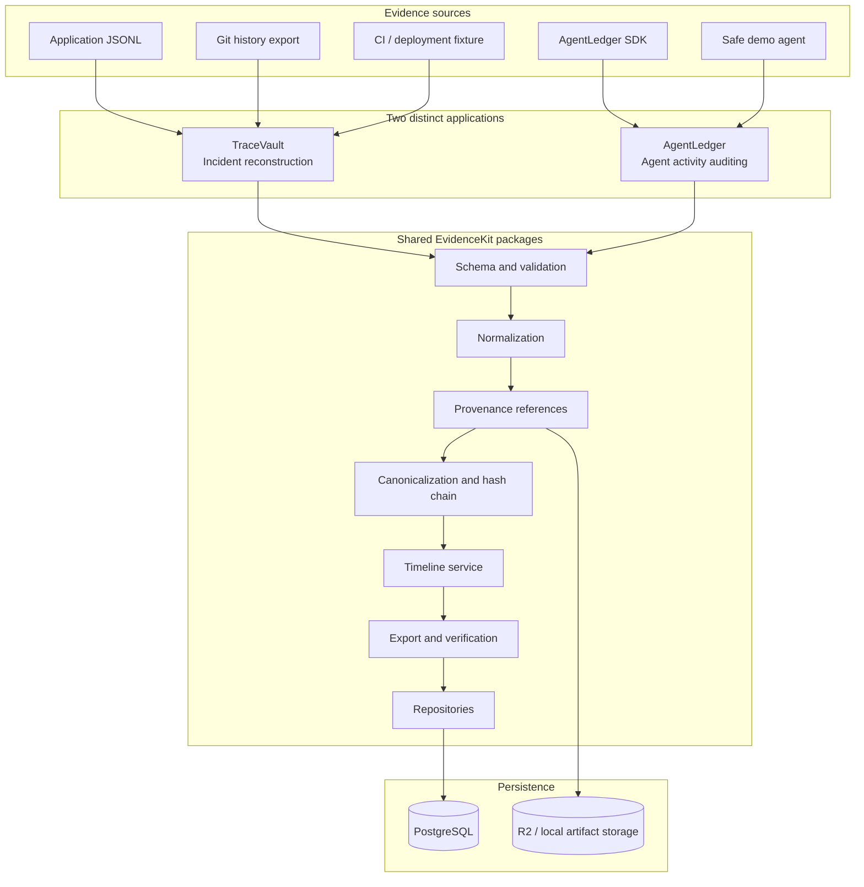

# EvidenceKit — Product Requirements, Architecture & Delivery Plan

**Event:** Kiroween 2026  
**Target category:** Skeleton Crew  
**Product type:** Reusable, tamper-evident event-evidence engine demonstrated through two distinct applications  
**Owner:** Solo developer  
**Document status:** Build specification / living project plan  
**Created:** 30 October 2026  
**Target submission deadline:** 4 December 2026, 2:00 PM Pacific Time (5 December 2026, 3:30 AM IST)  
**Primary repository:** `evidencekit`  
**Application 1:** `TraceVault` — software incident reconstruction  
**Application 2:** `AgentLedger` — AI-agent activity auditing

> **Product promise:** EvidenceKit turns events and source artifacts from different systems into a consistent, traceable timeline whose captured records can be checked for later modification. The same reusable engine powers two separate applications: TraceVault for software incidents and AgentLedger for instrumented AI-agent sessions.

---

## 1. Executive Summary

EvidenceKit is a small, reusable evidence-processing foundation for reconstructing what happened during a technical incident or an AI-agent session. It accepts structured events and source artifacts, validates and normalizes them, preserves references to the original evidence, appends normalized events to a tamper-evident hash chain, and presents a timeline that can be inspected and exported.

EvidenceKit is the shared foundation, not the user-facing application by itself. It must be demonstrated through two genuinely different applications:

1. **TraceVault:** reconstructs a software incident from deployment records, CI logs, application logs and Git history. It helps a developer inspect the sequence of events and find evidence-backed relationships between them.
2. **AgentLedger:** records and audits actions from an instrumented AI-agent workflow, including tool calls, approvals, outcomes and file-change metadata. It helps a reviewer understand what the agent did, what was approved and what evidence was captured.

The shared workflow is:

1. An application creates or imports an evidence stream (an incident case or an agent session).
2. Source adapters parse input records and retain provenance about where each record came from.
3. The shared normalizer maps source records to a versioned EvidenceKit event envelope.
4. The system validates, sanitizes and redacts sensitive fields before persistence.
5. Events are appended in ingestion order to a per-stream SHA-256 hash chain using deterministic JSON canonicalization.
6. The user sees a timeline sorted by event time, with each event linked to its source artifact and original record location.
7. The user can verify the chain, inspect any failures and export a portable evidence bundle.

### 1.1 One-sentence pitch

**EvidenceKit is a reusable evidence engine that reconstructs software incidents and AI-agent sessions from source events, preserves provenance, and makes post-capture modification detectable.**

### 1.2 Why two applications?

The Skeleton Crew category asks entrants to build a reusable foundation and demonstrate its versatility through two distinct applications. EvidenceKit meets this by sharing event normalization, provenance, timeline, chain-integrity and export capabilities while giving each application a different audience, workflow, source adapter and result.

The two applications must not be thinly themed copies of one dashboard:

- TraceVault's primary object is an **incident case** assembled from deployment, CI, Git and application evidence.
- AgentLedger's primary object is an **agent session** assembled from tool-call, approval, action and file-change events.

### 1.3 Product positioning and honest claims

EvidenceKit can demonstrate that captured events and artifact references have not changed relative to a recorded chain and, when enabled, a signed export manifest. It cannot independently prove that a source system told the truth, that every possible event was captured, that source timestamps were accurate, or that an inferred relationship is causal.

The product must use precise language:

- Say **tamper-evident after capture**, not tamper-proof.
- Say **evidence-backed timeline**, not definitive reconstruction of reality.
- Say **candidate relationship** or **correlation**, not proven root cause, unless a user supplies independent proof.
- Say **instrumented agent actions**, not all actions of any arbitrary agent.
- A hash chain proves integrity of the captured sequence only when its head is retained or anchored. A signed export manifest improves the ability to detect later changes to an exported bundle, but does not prove completeness or truthfulness of collection.

---

## 2. Goals, Non-Goals and Success Measures

### 2.1 Product goals

| ID   | Goal                                     | Success measure                                                                                                       |
| ---- | ---------------------------------------- | --------------------------------------------------------------------------------------------------------------------- |
| G-01 | Provide one shared, reusable event model | Both applications create and display the same versioned event envelope                                                |
| G-02 | Preserve evidence provenance             | Every imported event can identify its source artifact and record location where available                             |
| G-03 | Make event changes detectable            | Chain verification detects modified, reordered, inserted or removed records in a test bundle                          |
| G-04 | Create useful timelines                  | Events are displayed by occurrence time while preserving the original append/ingestion sequence separately            |
| G-05 | Demonstrate TraceVault                   | A sample incident bundle becomes a timeline with source references and a cautious incident summary                    |
| G-06 | Demonstrate AgentLedger                  | A controlled agent workflow records tool calls, approvals, outcomes and file metadata                                 |
| G-07 | Make evidence portable                   | Users can export and re-import a documented EvidenceKit bundle and verify it                                          |
| G-08 | Demonstrate reusable engineering         | TraceVault and AgentLedger both use the same shared packages, with separate app folders and independent flows         |
| G-09 | Use Kiro meaningfully                    | Repository contains Kiro specs, steering, hooks and automated tests; the submission explains actual use               |
| G-10 | Protect sensitive information            | Secrets and sensitive content are redacted or excluded by default, with explicit user control over artifact retention |

### 2.2 Non-goals for the hackathon MVP

Do not build these before the two core applications work:

- A universal SIEM, SOC platform or enterprise observability product.
- Full support for every CI provider, log vendor, agent framework or tracing format.
- A claim of cryptographic non-repudiation or legal forensic certification.
- A public blockchain or distributed ledger.
- An immutable storage service with WORM compliance.
- Automatic root-cause determination or autonomous incident remediation.
- An arbitrary shell-execution agent or unrestricted code-execution sandbox.
- A general-purpose agent monitor that can capture actions from agents which have not been instrumented.
- Full OpenTelemetry Collector/OTLP ingestion in the first release; support a documented JSON event/bundle format first.
- A complex multi-tenant SaaS with billing, teams and enterprise RBAC.
- A streaming ingestion platform or Kafka-scale architecture.
- An elaborate graph visualization that substitutes for evidence quality.

### 2.3 MVP success measures

| Metric                  |                                                                        Target for acceptance | Measurement                  |
| ----------------------- | -------------------------------------------------------------------------------------------: | ---------------------------- |
| Shared event schema     |                                                       100% of persisted app events validated | Zod schema tests             |
| Source provenance       |       Every imported TraceVault event has a source reference where parser input supports one | Adapter integration tests    |
| Hash-chain verification |                              100% valid fixture chains pass; all seeded tampering tests fail | Verification test suite      |
| Timeline correctness    |                             Stable sort by occurred-at, then ingestion sequence and event ID | Deterministic ordering tests |
| TraceVault import       |                    Demonstration bundle of at least 100 events imports and renders correctly | Automated fixture test       |
| AgentLedger session     |                               Demo agent records at least 8 different event types in one run | End-to-end test              |
| Agent approval          |                                       A denied write action does not modify the sandbox file | Security/integration test    |
| Export/re-import        |                                                     Exported bundle verifies after re-import | Round-trip tests             |
| Sensitive data          |                    Test secrets are redacted before display and excluded from event payloads | Redaction tests              |
| UI accessibility        | No critical/serious automated violations in primary journeys; keyboard path manually checked | axe-core and manual checks   |
| Demo reliability        |                     Primary demo can run from bundled fixtures without external integrations | Repeated rehearsal           |

These targets are engineering acceptance criteria, not claimed results. Record the actual measured values before submission.

---

## 3. Category Fit and Kiroween Constraints

### 3.1 Intended category: Skeleton Crew

The category is appropriate because EvidenceKit is a reusable foundation shown through two distinct applications. The root repository must contain two separate application folders for those applications, as required by the supplied Kiroween rules.

Recommended structure:

```text
evidencekit/
├── .kiro/
├── apps/
│   ├── tracevault/       # Application 1
│   └── agentledger/      # Application 2
├── packages/
│   ├── evidence-core/    # Shared event model, canonicalization, chain verification
│   ├── evidence-server/  # Shared persistence and application services
│   ├── adapters/         # TraceVault source parsers
│   ├── agent-sdk/        # AgentLedger capture SDK
│   ├── db/               # Shared schema, migrations and repositories
│   └── ui/               # Small shared design primitives only
├── fixtures/
├── docs/
├── scripts/
├── package.json
├── pnpm-workspace.yaml
├── README.md
└── LICENSE
```

The two apps must have distinct product identities and end-to-end functionality. The shared foundation should be visible in imports, tests, architecture documentation and the demo.

### 3.2 Submission constraints

- The project must be newly created during the Kiroween submission period.
- Build the working software using Kiro (IDE, CLI, Web and/or Crew).
- Select one primary category for this submission: Skeleton Crew.
- Provide a working application URL and public GitHub repository.
- Include a recognized open-source license.
- Keep `.kiro/` at the repository root and do not ignore it in Git.
- Include two separate application folders for TraceVault and AgentLedger.
- Provide a public YouTube demonstration video under three minutes.
- Include all necessary source, assets and setup instructions.
- Explain real Kiro usage in the submission: specs, steering, hooks, MCP, custom agents and testing where actually used.

Do not claim that a Kiro feature was used if it was not used. Keep evidence of development decisions and Kiro-assisted workflows as the project is built.

---

## 4. Users and Primary Journeys

### 4.1 TraceVault user

A developer or technical operator has a failed deployment and wants to understand the sequence of events using existing logs and records.

**TraceVault journey:**

1. Open TraceVault and create an incident case.
2. Upload a sample evidence bundle or selected supported files.
3. Select the source type for each artifact if it is not detected automatically.
4. Review the import preview, parser warnings and file hashes.
5. Import the bundle and normalize the supported records.
6. Inspect the event timeline, sorted by occurrence time.
7. Open an event to inspect its attributes, source file and line/record reference.
8. View candidate event relationships, clearly marked as correlation rather than proven causation.
9. Run chain verification.
10. Export a portable EvidenceKit report and bundle.

### 4.2 AgentLedger user

A developer wants to inspect what an instrumented AI agent did during one controlled coding task.

**AgentLedger journey:**

1. Open AgentLedger and create an agent session.
2. Choose the built-in safe demo workflow.
3. Run the demo agent through read, inspect, propose-change and approval steps.
4. Inspect tool-call start/end events and outcomes.
5. Approve or deny a proposed write action.
6. Inspect file metadata and before/after hashes for an approved sandbox change.
7. View the session timeline and chain status.
8. Export the session evidence bundle.
9. Verify the exported bundle independently.

### 4.3 Reviewer/judge journey

A judge should be able to open both public demo applications without creating an account, inspect preloaded sample cases and sessions, and verify an exported bundle. Mutating operations (upload, create, run demo session, delete) should require the owner account or be disabled in public demo mode.

---

## 5. Product Scope and Feature Priorities

Use the following priority levels:

- **P0:** Required for the Skeleton Crew MVP and demo.
- **P1:** Important improvements after the core workflows work.
- **P2:** Stretch features; do not risk the core submission for these.

| Feature                             | Priority | Shared / app | Description                                                        |
| ----------------------------------- | -------- | ------------ | ------------------------------------------------------------------ |
| Versioned event envelope            | P0       | Shared       | Common validated event model                                       |
| Event normalization                 | P0       | Shared       | Map supported sources to canonical fields                          |
| Evidence references                 | P0       | Shared       | Source artifact and line/record references                         |
| Artifact hashing                    | P0       | Shared       | SHA-256 for uploaded artifacts                                     |
| Hash chain                          | P0       | Shared       | Per-stream append-only integrity sequence                          |
| Chain verification                  | P0       | Shared       | Verify event hashes, links, sequence and head                      |
| Timeline service                    | P0       | Shared       | Sort by event time, retain ingest sequence                         |
| JSON export/import                  | P0       | Shared       | Portable evidence bundle format                                    |
| Redaction/sanitization              | P0       | Shared       | Remove common secret patterns and unsafe content                   |
| TraceVault fixture import           | P0       | TraceVault   | Import included sample incident bundle                             |
| JSONL application log adapter       | P0       | TraceVault   | Parse timestamped structured logs                                  |
| Git history adapter                 | P0       | TraceVault   | Parse exported `git log` JSON/CSV fixture                          |
| CI/deployment adapter               | P0       | TraceVault   | Parse documented normalized fixture format                         |
| TraceVault incident timeline        | P0       | TraceVault   | Inspect events and source evidence                                 |
| Candidate event correlations        | P1       | TraceVault   | Show temporal/source-based associations with explanation           |
| GitHub read-only integration        | P1       | TraceVault   | Import commits/workflow metadata using explicit token              |
| Report export                       | P0       | TraceVault   | Download case report and evidence bundle                           |
| AgentLedger safe demo runner        | P0       | AgentLedger  | Executes a fixed, sandboxed tool sequence                          |
| Agent SDK                           | P0       | AgentLedger  | Capture instrumented tool lifecycle events                         |
| Approval events                     | P0       | AgentLedger  | Record approve/deny decision and actor                             |
| File change evidence                | P0       | AgentLedger  | Record path label, diff stats and content hashes                   |
| Agent session replay                | P1       | AgentLedger  | Reconstruct the event sequence from captured events                |
| Generic MCP instrumentation adapter | P2       | AgentLedger  | Add events for supported MCP client/tool flows                     |
| Signed export manifest              | P1       | Shared       | Ed25519 signature for a finalized bundle manifest                  |
| Read-only public demo               | P0       | Both         | Preloaded cases/sessions for judges                                |
| User/team management                | P2       | Shared       | Not required for hackathon MVP                                     |
| OpenTelemetry JSON adapter          | P2       | TraceVault   | Import a bounded documented subset of exported events              |
| AI narrative summary                | P2       | Both         | Optional evidence-linked summary; never required for core analysis |

---

## 6. Functional Requirements

Each requirement uses a stable ID so it can be linked to a Kiro spec and a test.

### 6.1 Shared EvidenceKit engine

| ID        | Requirement              | Acceptance criteria                                                                                      | Priority |
| --------- | ------------------------ | -------------------------------------------------------------------------------------------------------- | -------- |
| EK-FR-001 | Canonical event envelope | Event is validated against a versioned schema before persistence                                         | P0       |
| EK-FR-002 | Event identity           | Every event has a unique event ID and stream ID                                                          | P0       |
| EK-FR-003 | Time fields              | Store `occurred_at` and `observed_at` separately; preserve timezone/precision when known                 | P0       |
| EK-FR-004 | Time confidence          | Record whether timestamp is source-provided, inferred, or ingestion-time fallback                        | P0       |
| EK-FR-005 | Source metadata          | Store source system, source artifact ID and adapter/version metadata                                     | P0       |
| EK-FR-006 | Payload validation       | Reject malformed structural fields and safely handle unknown optional fields                             | P0       |
| EK-FR-007 | Redaction                | Redact common tokens/passwords/secret patterns before persistent event payload creation                  | P0       |
| EK-FR-008 | Provenance references    | Attach filename, artifact digest and line/record/JSON pointer where available                            | P0       |
| EK-FR-009 | Artifact digest          | Calculate SHA-256 for every retained uploaded artifact                                                   | P0       |
| EK-FR-010 | Event normalization      | Source adapters produce the same canonical envelope                                                      | P0       |
| EK-FR-011 | Append sequence          | Each stream has monotonically increasing ingestion sequence numbers                                      | P0       |
| EK-FR-012 | Hash chain               | Every event references the preceding event hash and has a computed event hash                            | P0       |
| EK-FR-013 | Atomic append            | Event insert and chain-head update occur in one database transaction                                     | P0       |
| EK-FR-014 | Chain verification       | Verify sequence continuity, previous hashes, event hashes and stream head                                | P0       |
| EK-FR-015 | Timeline ordering        | Display by `occurred_at`; tie-break by ingest sequence then event ID                                     | P0       |
| EK-FR-016 | Late events              | Late-arriving events can appear earlier in the timeline without rewriting the hash chain                 | P0       |
| EK-FR-017 | Evidence inspection      | User can see the source artifact and original record locator                                             | P0       |
| EK-FR-018 | Portable export          | Export events, references, artifact digests, stream metadata and chain verification result               | P0       |
| EK-FR-019 | Import verification      | Re-imported export is independently verified before it is marked valid                                   | P0       |
| EK-FR-020 | Idempotency              | Re-import with the same bundle ID and idempotency key does not silently duplicate the stream             | P0       |
| EK-FR-021 | Integrity status         | Show `verified`, `failed` or `not anchored` accurately; never show a green state for an incomplete check | P0       |
| EK-FR-022 | Deletion                 | Owner can delete a case/session and its artifacts according to documented retention behaviour            | P0       |
| EK-FR-023 | Export signature         | Optionally sign the export manifest with Ed25519 and verify with a public key                            | P1       |
| EK-FR-024 | Event schema evolution   | Every event carries a schema version; migration rules are explicit                                       | P1       |
| EK-FR-025 | Standard conventions     | Reuse OpenTelemetry event names/attributes when appropriate without claiming full OTLP compatibility     | P1       |

### 6.2 TraceVault requirements

| ID        | Requirement              | Acceptance criteria                                                                     | Priority |
| --------- | ------------------------ | --------------------------------------------------------------------------------------- | -------- |
| TV-FR-001 | Create incident case     | Owner can create a case with title, summary, environment and time window                | P0       |
| TV-FR-002 | Upload incident bundle   | Accept a bounded ZIP or supported individual files                                      | P0       |
| TV-FR-003 | Preview import           | Show file names, detected source type, sizes and parser warnings before import          | P0       |
| TV-FR-004 | Application JSONL parser | Parse one JSON object per line with source line numbers                                 | P0       |
| TV-FR-005 | Git history parser       | Parse documented `git log` output with commit hash, author, date, subject and refs      | P0       |
| TV-FR-006 | CI/deployment parser     | Parse included JSON fixture schema for workflow/deployment events                       | P0       |
| TV-FR-007 | Import errors            | Report malformed records with file and line number; do not silently discard             | P0       |
| TV-FR-008 | Case timeline            | Show all normalized events from the case                                                | P0       |
| TV-FR-009 | Event detail             | Show timestamp, source, attributes, evidence references and hash status                 | P0       |
| TV-FR-010 | Correlation hints        | Show candidate relationships with explicit rules and supporting event IDs               | P1       |
| TV-FR-011 | Incident summary         | Generate deterministic template summary from selected events; optional AI summary later | P0       |
| TV-FR-012 | GitHub import            | Read repository commit/workflow metadata with read-only permission                      | P1       |
| TV-FR-013 | Case report              | Export Markdown/HTML and machine-readable JSON bundle                                   | P0       |
| TV-FR-014 | Public sample            | Judge can open a preloaded sample incident without login                                | P0       |

#### TraceVault supported input formats for MVP

1. **Application log JSONL:** One JSON object per line. Example keys: `timestamp`, `level`, `service`, `message`, `trace_id`, `attributes`.
2. **Git history JSON:** Exported by the included helper script; avoid relying on arbitrary human-formatted Git log output.
3. **CI/deployment JSON:** A documented EvidenceKit fixture schema with event time, environment, workflow, status, deployment ID and optional commit SHA.
4. **EvidenceKit normalized JSON:** Used for round-trip import/export tests.

The first release should include a bundled synthetic incident pack. Optional GitHub integration is a convenience, not a prerequisite for a successful demo.

#### TraceVault deterministic correlation rules

P0 summary must be deterministic and evidence-linked. P1 correlation hints may include:

- A failed deployment and a subsequent increase in application errors within a configured time window.
- A CI failure and a commit to the same repository/branch.
- Several service failures sharing a trace ID or deployment identifier.
- A migration event followed by a database error from a service that references the same deployment.

Every hint must show the rule, time window and contributing event IDs. It must be labelled **candidate relationship**, not root cause. AI-generated explanations are optional P2 and must cite event IDs for each factual claim.

### 6.3 AgentLedger requirements

| ID        | Requirement                | Acceptance criteria                                                                       | Priority |
| --------- | -------------------------- | ----------------------------------------------------------------------------------------- | -------- |
| AL-FR-001 | Create session             | Owner can create an agent session with goal, agent label and environment                  | P0       |
| AL-FR-002 | Agent event SDK            | SDK emits validated events to the session endpoint                                        | P0       |
| AL-FR-003 | Tool call start            | Record tool name, call ID, start time and redacted argument metadata                      | P0       |
| AL-FR-004 | Tool call finish           | Record end time, duration, status and safe result summary                                 | P0       |
| AL-FR-005 | Approval request           | Record the proposed action and required permission                                        | P0       |
| AL-FR-006 | Approval decision          | Record approve/deny, actor and decision time                                              | P0       |
| AL-FR-007 | File evidence              | Record sandbox path label, before/after SHA-256 and diff statistics                       | P0       |
| AL-FR-008 | Failure event              | Record tool error category without storing secrets or full sensitive stack payloads       | P0       |
| AL-FR-009 | Controlled demo agent      | Run read, inspect, propose-change and approval actions in a safe sandbox                  | P0       |
| AL-FR-010 | Denied action              | A denied write action must not change the sandbox file                                    | P0       |
| AL-FR-011 | Session timeline           | Display actions and approval sequence in event-time order                                 | P0       |
| AL-FR-012 | Session verification       | Verify the shared EvidenceKit chain for the session                                       | P0       |
| AL-FR-013 | Session export             | Download JSON bundle with event and file evidence metadata                                | P0       |
| AL-FR-014 | Session replay             | Reconstruct a readable sequence from captured events                                      | P1       |
| AL-FR-015 | Generic framework adapters | Add optional wrappers for supported agent/tool systems                                    | P2       |
| AL-FR-016 | MCP event adapter          | Capture tool-call lifecycle when the application controls or instruments the MCP boundary | P2       |

#### AgentLedger MVP safety model

The built-in demo agent must not execute arbitrary shell commands or modify the real repository. It operates in a dedicated sandbox directory with a small allowlist of tools:

- `list_workspace_files`
- `read_workspace_file`
- `inspect_file_metadata`
- `propose_file_change`
- `approve_proposed_change`
- `deny_proposed_change`
- `apply_approved_change`

The tool runner must enforce permissions server-side. A UI state alone is not an authorization boundary.

The first release should use a deterministic, scripted tool sequence rather than an unrestricted autonomous agent. This makes the demo repeatable and the recorded evidence testable. An optional LLM-driven agent can be added later, but must use the same controlled tool boundary.

---

## 7. Non-Functional Requirements

| ID      | Area               | Requirement                                          | Acceptance target                                                                                                      |
| ------- | ------------------ | ---------------------------------------------------- | ---------------------------------------------------------------------------------------------------------------------- |
| NFR-001 | Reliability        | Failed parsing must not corrupt existing streams     | Transaction rollback and parser-isolation tests pass                                                                   |
| NFR-002 | Integrity          | Hash-chain computation must be deterministic         | Same canonical event and previous hash produce identical hash                                                          |
| NFR-003 | Integrity          | Chain append must be atomic                          | Concurrent append test yields no duplicate sequence numbers                                                            |
| NFR-004 | Time               | Occurrence and observation times remain distinct     | UI displays both when they differ materially                                                                           |
| NFR-005 | Performance        | Timeline of 1,000 events loads smoothly              | Target p95 < 1 second on the demo deployment after pagination/indexing                                                 |
| NFR-006 | Performance        | Bundle import is bounded                             | 5 MB synthetic fixture with 5,000 events completes within 10 seconds on local reference machine; measure on deployment |
| NFR-007 | Upload safety      | Limit untrusted bundles                              | Default ZIP compressed size ≤ 20 MB, total expanded size ≤ 100 MB, max 200 entries; configurable server-side           |
| NFR-008 | Security           | Authentication required for write operations         | Public judge mode is read-only                                                                                         |
| NFR-009 | Security           | No secret capture by default                         | Known token/password patterns are redacted; full prompts/results are off by default                                    |
| NFR-010 | Security           | Prevent path traversal and archive bombs             | Reject absolute paths, `..` paths, symlinks and excessive expansion                                                    |
| NFR-011 | Privacy            | User controls evidence retention                     | Delete flow and retention note are documented                                                                          |
| NFR-012 | Accessibility      | Core flows are keyboard accessible                   | Manual keyboard review plus automated axe checks                                                                       |
| NFR-013 | Compatibility      | Target current desktop Chromium and Firefox          | Main demo journeys tested in at least one Chromium browser; basic cross-browser check                                  |
| NFR-014 | Maintainability    | Shared logic lives in packages                       | Apps do not duplicate normalization, chain or export code                                                              |
| NFR-015 | Observability      | The product itself logs operational failures safely  | Structured server logs without secrets or uploaded raw payloads                                                        |
| NFR-016 | Cost               | Demo works without paid LLM APIs                     | AI summary is optional; all core workflows are deterministic                                                           |
| NFR-017 | Export portability | Bundle format is versioned and documented            | Bundle can be verified after download and re-import                                                                    |
| NFR-018 | Data integrity     | Original artifacts are represented by content hashes | SHA-256 digest is computed on upload and rechecked on export/verification                                              |

Targets are initial engineering goals. Measure them with a documented test environment; do not state them as achieved until verified.

---

## 8. UX and Visual Design Requirements

### 8.1 Shared design language

EvidenceKit should look like a professional evidence investigation tool, not a generic admin template. Shared components should include:

- Stream status badge: `Verified`, `Failed`, `Unanchored`, `Processing`.
- Event severity badge.
- Source-system icon/label.
- Provenance panel.
- Event detail drawer.
- Timeline row.
- Chain verification panel.
- Export action and report preview.
- Empty, loading, invalid-file and error states.

Use a restrained dark-neutral interface with high-contrast text and one accent colour. Avoid excessive animations. Preserve a consistent shared component system while giving the two apps different information architecture and primary actions.

### 8.2 TraceVault screens

1. **Cases home:** case list, status, latest event, verification state.
2. **Create/import case:** upload bundle, inspect files, select adapters and preview parser warnings.
3. **Incident overview:** time window, services, deployment markers, event count and cautious summary.
4. **Timeline:** filter by time, source, severity, service and event type.
5. **Event detail:** normalized data, original source location, artifact digest and chain details.
6. **Correlation panel:** candidate relationships with rule and supporting event IDs.
7. **Export/verify:** export bundle, download report and verify chain.

### 8.3 AgentLedger screens

1. **Sessions home:** session list, agent label, outcome and verification status.
2. **Create session:** session goal, sandbox label and demo workflow selection.
3. **Live run view:** action lifecycle, approval requests and run status.
4. **Action timeline:** tool-call events, approval decisions and file changes.
5. **Action detail:** redacted input metadata, result status, file hashes and source references.
6. **Sandbox diff:** before/after file diff for approved changes only.
7. **Export/verify:** download session evidence and verify the chain.

### 8.4 User experience states

Every major operation must have:

- Loading/progress state.
- Empty state with a clear next action.
- Success state with a useful result.
- Recoverable error state with safe diagnostic context.
- Permission-denied state.
- Invalid evidence state with file/line/record location.
- Verification-failed state that does not hide or overwrite evidence.

---

## 9. Technical Architecture

### 9.1 Recommended stack

The stack is selected to minimize operational overhead for one developer and reuse TypeScript across both applications.

| Layer                  | Technology                                                                             | Why                                                                                  |
| ---------------------- | -------------------------------------------------------------------------------------- | ------------------------------------------------------------------------------------ |
| Monorepo               | pnpm workspaces                                                                        | Lightweight shared-package management                                                |
| Frontend apps          | Next.js App Router + React + TypeScript                                                | Two independently deployable applications with shared packages                       |
| Styling                | Tailwind CSS + shadcn/ui                                                               | Fast, consistent accessible interface development                                    |
| Charts                 | Recharts                                                                               | Simple event, severity and duration charts                                           |
| Timeline visualization | Custom virtualized list first; React Flow only for optional correlation graph          | Avoid an overbuilt graph UI                                                          |
| API                    | Next.js Route Handlers (Node.js runtime)                                               | Keeps deployment and API operations simple; both apps can call shared server package |
| Validation             | Zod                                                                                    | Runtime validation for uploaded and SDK event payloads                               |
| Database               | PostgreSQL                                                                             | Transactions, relational integrity and indexed event queries                         |
| ORM/migrations         | Drizzle ORM + drizzle-kit                                                              | Typed SQL schema and explicit migrations                                             |
| Hosting DB             | Neon PostgreSQL or equivalent managed PostgreSQL                                       | Managed database without operating a database server                                 |
| Artifact storage       | Cloudflare R2 (S3-compatible) for deployed artifacts; local filesystem for development | Store bounded uploads separately from relational metadata                            |
| File parsing           | Node streams, `unzipper` or a maintained ZIP parser, custom bounded adapters           | Avoid reading unbounded uploads into memory                                          |
| Canonical JSON         | RFC 8785 JSON Canonicalization Scheme implementation                                   | Stable JSON bytes before hashing/signing                                             |
| Hashing/signatures     | Node.js `crypto`: SHA-256; Ed25519 for optional signed manifests                       | Native cryptographic primitives                                                      |
| Agent SDK              | TypeScript package `@evidencekit/agent-sdk`                                            | Controlled instrumentation for AgentLedger workflows                                 |
| Auth                   | Auth.js GitHub OAuth allowlist for owner writes                                        | Protect mutations while keeping public demo read-only                                |
| Testing                | Vitest + fast-check + Playwright + axe-core                                            | Unit, property-based, E2E and accessibility tests                                    |
| CI                     | GitHub Actions                                                                         | Lint, typecheck, test and build on pull request/push                                 |
| Deployment             | Two Vercel projects (one per app), shared Neon DB and R2 bucket                        | Keeps the two applications separately addressable                                    |

Use current stable compatible package versions when implementation starts and commit the lockfile. Do not copy arbitrary version numbers from a tutorial. Next.js App Router and Drizzle's PostgreSQL integration are documented in their official guides.

### 9.2 Why not add a separate Python or microservice backend?

For this hackathon, the normalization, hashing, persistence, export and controlled agent recorder can all be implemented in TypeScript. A separate FastAPI service would add deployment, authentication and contract-maintenance work without being necessary for the MVP. If an optional ML/AI analysis service is added later, put it behind a versioned adapter rather than making it a core dependency.

### 9.3 Architecture overview



### 9.4 Request/data processing flow

1. Authenticate and authorize the operation.
2. Validate upload/event size and declared content type.
3. Compute artifact SHA-256 before parsing.
4. Store the artifact only according to retention policy and user consent.
5. Select the source adapter.
6. Parse records with bounded memory and record source locators.
7. Normalize each record to the canonical event envelope.
8. Sanitize/redact sensitive values.
9. Validate the canonical event schema.
10. Append events transactionally to the selected stream hash chain.
11. Update the stored chain head in the same database transaction.
12. Generate/refresh the event-time timeline projection.
13. Return import/verification status and parser warnings.

### 9.5 Time and ordering model

EvidenceKit must distinguish:

- `occurred_at`: when the source says the event occurred.
- `observed_at`: when EvidenceKit received/parsed the event.
- `ingest_sequence`: append order inside the evidence stream.
- `time_confidence`: `source_timestamp`, `inferred`, or `ingestion_fallback`.

The integrity chain is appended in ingestion order. The timeline is displayed in occurrence-time order. A late-arriving event can therefore appear earlier in the visual timeline without changing existing chain links.

If source timestamps conflict, have no timezone, or appear implausible, preserve the original value and show a timestamp warning. Do not silently rewrite source times.

---

## 10. Canonical Event Model

### 10.1 Event envelope

Use a versioned envelope. This is the shared contract for both applications.

```json
{
  "schema_version": "1.0",
  "event_id": "0192d8c0-6f3b-7b72-8ad1-1e3e5a1d1001",
  "stream_type": "tracevault.case",
  "stream_id": "case_01HZX9QK2M",
  "event_name": "deployment.completed",
  "occurred_at": "2026-11-16T10:02:14.000Z",
  "observed_at": "2026-11-16T10:05:02.000Z",
  "time_confidence": "source_timestamp",
  "source": {
    "system": "ci_fixture",
    "artifact_id": "artifact_01",
    "adapter": "ci-json-v1",
    "adapter_version": "1.0.0"
  },
  "actor": {
    "type": "service",
    "id": "deploy-runner"
  },
  "severity": "info",
  "correlation_ids": ["deploy-482", "commit-a81c2e"],
  "attributes": {
    "environment": "staging",
    "service": "api",
    "status": "failed",
    "commit_sha": "a81c2e"
  },
  "evidence_refs": [
    {
      "artifact_id": "artifact_01",
      "locator_type": "json_pointer",
      "locator": "/deployments/3"
    }
  ]
}
```

Hash metadata is stored beside the envelope, not inside the canonical envelope being hashed:

```json
{
  "stream_sequence": 12,
  "previous_hash": "<64 lowercase hex characters>",
  "event_hash": "<64 lowercase hex characters>",
  "hash_algorithm": "sha-256",
  "canonicalization": "RFC8785-JCS"
}
```

### 10.2 Required event fields

| Field             | Type               | Requirement                                           |
| ----------------- | ------------------ | ----------------------------------------------------- |
| `schema_version`  | string             | Required                                              |
| `event_id`        | UUID/string        | Required and unique within stored data                |
| `stream_type`     | enum/string        | Required (`tracevault.case` or `agentledger.session`) |
| `stream_id`       | string             | Required                                              |
| `event_name`      | string             | Required and bounded length                           |
| `occurred_at`     | ISO timestamp/null | Source timestamp or explicit null/fallback policy     |
| `observed_at`     | ISO timestamp      | Required                                              |
| `time_confidence` | enum               | Required                                              |
| `source`          | object             | Required                                              |
| `actor`           | object/null        | Optional but structured                               |
| `severity`        | enum               | `debug`, `info`, `warning`, `error`, `critical`       |
| `correlation_ids` | string array       | Optional, bounded count and length                    |
| `attributes`      | JSON object        | Required, size-bounded and sanitized                  |
| `evidence_refs`   | array              | Optional, but expected for imported source events     |

### 10.3 Canonicalization and hash formula

Use RFC 8785 JSON Canonicalization Scheme (JCS) or a fully conformant maintained implementation before hashing. Do not use arbitrary `JSON.stringify()` as a cryptographic canonicalization format unless its exact behaviour is deliberately specified and tested.

For stream event `i`:

```text
canonical_event_i = JCS(event_envelope_i)

hash_input_i =
  UTF8("EvidenceKit:event:v1\n") ||
  HEX_DECODE(previous_hash_i) ||
  UTF8("\n") ||
  UTF8(canonical_event_i)

event_hash_i = SHA256(hash_input_i)
```

For the first event, `previous_hash` is 32 zero bytes represented as 64 lowercase hexadecimal zero characters.

The chain record stores:

- Stream identifier.
- Sequence number.
- Previous hash.
- Event hash.
- Hash algorithm/version.
- Canonicalization version.
- Canonical event bytes or enough immutable event data to re-create them.

A verifier must recompute every event hash in sequence and compare the result to the recorded hash and chain head.

### 10.4 Atomic append and concurrency

Appending an event must be a single database transaction:

1. Lock the stream's chain-head row (`SELECT ... FOR UPDATE` or equivalent).
2. Read the current sequence and head hash.
3. Compute the next event hash.
4. Insert the event and chain metadata.
5. Update the chain-head sequence/hash.
6. Commit.

Enforce a unique database constraint on `(stream_id, stream_sequence)` and a unique event ID. If concurrent appends occur, one transaction must retry or fail safely; it must never create two events with the same sequence.

### 10.5 What the chain does and does not prove

The chain detects changes relative to the stored/anchored head. It does not prove that events were truthful, that every event was captured, or that source timestamps were accurate.

A finalized export should include an integrity manifest containing stream ID, event count, first/last sequence, chain head, artifact digests, format version and export timestamp. P1 may sign the manifest using Ed25519, with the verification public key included in the export or published separately.

Do not claim that a hash chain alone makes a database immutable. A privileged attacker who can rewrite all events and the stored head may be able to rebuild the chain. A previously signed or externally retained manifest makes later changes more detectable.

---

## 11. Data Model and Database Design

Use PostgreSQL with Drizzle ORM. Store JSONB for versioned event envelopes and explicit relational columns for important query/filter fields.

### 11.1 Core tables

| Table                 | Important fields                                                                                                                                            | Purpose                                              |
| --------------------- | ----------------------------------------------------------------------------------------------------------------------------------------------------------- | ---------------------------------------------------- |
| `workspaces`          | `id`, `name`, `created_at`                                                                                                                                  | Owner/demo data boundary                             |
| `users`               | `id`, `provider_subject`, `email`, `role`                                                                                                                   | Owner identity and reviewer/read-only role if needed |
| `cases`               | `id`, `workspace_id`, `title`, `environment`, `status`, `created_at`                                                                                        | TraceVault incident case                             |
| `agent_sessions`      | `id`, `workspace_id`, `agent_name`, `goal`, `status`, `created_at`                                                                                          | AgentLedger session                                  |
| `evidence_artifacts`  | `id`, `stream_id`, `filename`, `media_type`, `size_bytes`, `sha256`, `storage_key`, `retained_at`                                                           | Source artifact metadata                             |
| `events`              | `id`, `stream_id`, `stream_type`, `event_name`, `occurred_at`, `observed_at`, `ingest_sequence`, `severity`, `envelope_json`, `previous_hash`, `event_hash` | Canonical events and chain data                      |
| `chain_heads`         | `stream_id`, `last_sequence`, `head_hash`, `updated_at`                                                                                                     | Atomic stream head                                   |
| `event_evidence_refs` | `id`, `event_id`, `artifact_id`, `locator_type`, `locator`                                                                                                  | Event-to-source relationship                         |
| `agent_approvals`     | `id`, `session_id`, `tool_call_id`, `decision`, `actor_id`, `decided_at`                                                                                    | Explicit approval evidence                           |
| `exports`             | `id`, `stream_id`, `manifest_hash`, `signature`, `created_at`                                                                                               | Export history and optional signature metadata       |

### 11.2 Important constraints and indexes

- Unique `(stream_id, ingest_sequence)`.
- Unique `event_id`.
- Index `(stream_id, occurred_at)` for timeline queries.
- Index `(stream_id, event_name)` for filters.
- Index `(stream_id, severity)` for severity filters.
- Foreign keys from events and evidence references to their parent stream/artifact.
- Do not permit normal application update/delete operations against chain event rows.
- Store JSONB envelope and selected typed columns consistently; don't allow indexed columns to disagree with envelope fields.

### 11.3 Artifact storage

Development:

- Store uploads under an isolated local data directory outside the web root.
- Store only metadata in PostgreSQL.

Deployment:

- Use Cloudflare R2 or another S3-compatible object store for retained artifacts.
- Store object keys, not public object URLs, in the database.
- Use private bucket access and short-lived signed downloads.

EvidenceKit should support metadata-only mode: calculate and keep a digest plus a source locator while discarding the original artifact after parsing, when the user selects this option.

---

## 12. TraceVault — Detailed Application Design

### 12.1 TraceVault's job

TraceVault reconstructs an inspectable event sequence from a bounded set of software incident artifacts. It should help users understand what happened around a failure and quickly navigate to source evidence.

### 12.2 Import bundle format

Recommended fixture layout:

```text
sample-incident/
├── manifest.json
├── application-events.jsonl
├── git-history.json
├── ci-events.json
├── deployments.json
└── README.txt
```

`manifest.json` should identify bundle format version, case label, declared time window, included filenames, optional SHA-256 digests and expected adapter IDs.

### 12.3 Parser behaviour

- Detect parser by explicit manifest declaration or supported file extension plus content check.
- Never execute uploaded files, scripts or repository hooks.
- Parse streams incrementally where possible.
- Preserve raw line numbers or JSON pointers.
- Store parser version and import warnings.
- Treat unknown fields as safely bounded metadata where allowed.
- Reject unsupported encodings or mark them as unparsed.
- Report malformed records with source location; don't silently discard them.

### 12.4 TraceVault correlation engine

P0 should use explainable deterministic rules, not an opaque LLM root-cause claim.

Example rules:

| Rule       | Candidate relationship                            | Explanation                                                                      |
| ---------- | ------------------------------------------------- | -------------------------------------------------------------------------------- |
| TV-COR-001 | Deployment failure followed by application errors | Both occurred in a configured time window and share environment/service metadata |
| TV-COR-002 | CI failure and commit                             | Failed workflow references the same commit SHA                                   |
| TV-COR-003 | Migration and DB error                            | Events share deployment ID or service metadata within a time window              |
| TV-COR-004 | Repeated failures                                 | Several events share a trace/correlation ID                                      |

Every relationship must display:

- Rule ID and plain-language explanation.
- The time window used.
- The event IDs involved.
- Links to each original evidence reference.
- A label such as **candidate relationship**.

Do not calculate a numerical causal probability without a validated statistical model. A simple proximity rule is not proof of cause.

### 12.5 TraceVault outputs

- Timeline view.
- Import diagnostics.
- Event detail with provenance.
- Candidate relationship panel.
- Deterministic incident summary.
- Markdown/HTML report.
- Machine-readable EvidenceKit bundle.
- Verification result.

---

## 13. AgentLedger — Detailed Application Design

### 13.1 AgentLedger's job

AgentLedger records a controlled, instrumented agent workflow and makes the action sequence inspectable. The initial demo is a safe coding-agent simulation rather than an unrestricted autonomous coding system.

### 13.2 Agent event types

Minimum event types:

- `agent.session.created`
- `agent.run.started`
- `agent.tool.started`
- `agent.tool.completed`
- `agent.tool.failed`
- `agent.approval.requested`
- `agent.approval.decided`
- `agent.file.proposed`
- `agent.file.changed`
- `agent.run.completed`
- `agent.run.failed`

Every tool call should have a stable `tool_call_id` so start, approval and completion events can be correlated.

### 13.3 Safe demo scenario

Create a temporary sandbox containing a small sample repository:

```text
agent-sandbox/
├── README.md
├── src/
│   └── config.ts
└── tests/
    └── config.test.ts
```

Demo sequence:

1. Agent creates a session.
2. Agent lists files.
3. Agent reads `src/config.ts`.
4. Agent proposes a small, harmless edit.
5. Agent requests permission to apply the edit.
6. User approves or denies.
7. If approved, the sandbox file changes and before/after digests are recorded.
8. If denied, the file remains unchanged and the denial is recorded.
9. Agent run completes.
10. User verifies the chain and exports the session.

### 13.4 Agent SDK interface

Recommended minimal API:

```ts
interface EvidenceKitAgentRecorder {
  startSession(input: SessionStartInput): Promise<SessionRef>;
  toolStarted(input: ToolStartedInput): Promise<ToolCallRef>;
  approvalRequested(input: ApprovalRequestedInput): Promise<void>;
  approvalDecided(input: ApprovalDecisionInput): Promise<void>;
  toolCompleted(input: ToolCompletedInput): Promise<void>;
  toolFailed(input: ToolFailedInput): Promise<void>;
  fileChanged(input: FileChangeEvidenceInput): Promise<void>;
  completeSession(input: SessionCompleteInput): Promise<void>;
}
```

The SDK should validate and send only structured, bounded event data. It should not capture complete prompts, full tool inputs, access tokens or arbitrary file contents by default.

### 13.5 AgentLedger evidence policy

Default captured data:

- Tool name and call ID.
- Start/end timestamps and duration.
- Tool status.
- Redacted/allowlisted argument summary.
- Approval requirement and decision.
- Sandboxed file path label.
- Before/after SHA-256.
- Diff line counts and safe diff metadata.
- Result summary and error category.

Default excluded data:

- API keys, passwords, session cookies and authorization headers.
- Full prompts and model context.
- Full source code or file contents.
- Personal data unrelated to the action.
- Secrets found in environment variables or config files.

The user may explicitly attach a small evidence artifact for a demo, but the UI must warn about sensitive data before retaining it.

---

## 14. Evidence Provenance and Artifact Safety

### 14.1 Provenance model

Each event should provide as much of this information as the adapter can reliably capture:

- Source system.
- Original artifact ID and filename.
- Artifact SHA-256.
- Adapter and adapter version.
- Original line number, record number or JSON Pointer.
- Source event/record ID.
- Source timestamp and timezone if known.
- Ingestion timestamp.
- Redaction actions applied.

Missing provenance must be marked as unavailable rather than invented.

### 14.2 Redaction and sanitization

The product should:

- Detect common access-token, private-key, password and connection-string patterns.
- Replace detected values with typed placeholders such as `[REDACTED_TOKEN]`.
- Sanitize carriage returns, newlines and delimiter/control characters when rendering a one-line log field.
- Escape content for the output context.
- Preserve a flag showing that a field was redacted.
- Never store raw credentials in event payloads or application logs.

Redaction patterns are imperfect. State that the filter does not guarantee detection of every secret. Allow a user to discard raw artifacts after parsing.

### 14.3 ZIP upload protections

For uploaded bundles:

- Enforce compressed upload size limit (default 20 MB).
- Enforce total expanded size limit (default 100 MB).
- Enforce entry count limit (default 200).
- Reject absolute paths, `..` traversal, symlinks and suspicious archive structures.
- Reject executable content and do not execute any uploaded content.
- Restrict supported file extensions and validate content signatures where practical.
- Set parsing time limits and maximum record/line sizes.
- Store artifacts outside the public web root.

---

## 15. API Design

All endpoints should return a consistent JSON response shape and use Zod validation at the boundary.

### 15.1 Shared endpoints

| Method | Endpoint                        | Purpose                                 |
| ------ | ------------------------------- | --------------------------------------- |
| GET    | `/api/health`                   | Health/readiness check                  |
| GET    | `/api/streams/:streamId/events` | Paginated events and filters            |
| GET    | `/api/streams/:streamId/verify` | Verify chain and head                   |
| GET    | `/api/streams/:streamId/export` | Build/download EvidenceKit export       |
| POST   | `/api/streams/import`           | Import and verify an EvidenceKit bundle |

### 15.2 TraceVault endpoints

| Method | Endpoint                             | Purpose                       |
| ------ | ------------------------------------ | ----------------------------- |
| GET    | `/api/tracevault/cases`              | List cases                    |
| POST   | `/api/tracevault/cases`              | Create case                   |
| GET    | `/api/tracevault/cases/:id`          | Case detail                   |
| POST   | `/api/tracevault/cases/:id/import`   | Upload/parse source bundle    |
| GET    | `/api/tracevault/cases/:id/timeline` | Get event-time timeline       |
| GET    | `/api/tracevault/cases/:id/report`   | Generate deterministic report |

### 15.3 AgentLedger endpoints

| Method | Endpoint                                  | Purpose                      |
| ------ | ----------------------------------------- | ---------------------------- |
| GET    | `/api/agentledger/sessions`               | List sessions                |
| POST   | `/api/agentledger/sessions`               | Create session               |
| POST   | `/api/agentledger/sessions/:id/events`    | Append an instrumented event |
| POST   | `/api/agentledger/sessions/:id/approvals` | Record approval/denial       |
| POST   | `/api/agentledger/sessions/:id/demo/run`  | Run safe deterministic demo  |
| GET    | `/api/agentledger/sessions/:id/timeline`  | Get session timeline         |

### 15.4 API security

- Require authentication for all write endpoints except an explicitly configured local demo fixture setup.
- Enforce workspace and stream ownership server-side.
- Use per-session SDK token with a narrow scope and expiry for AgentLedger event ingestion.
- Rate-limit uploads and event appends.
- Validate `Content-Type`, request length and schema.
- Return generic error messages to public clients; keep safe diagnostic details in server logs.
- Do not accept arbitrary callback URLs or fetch user-supplied URLs in the MVP.

---

## 16. Export Bundle Format

A portable export should be independently verifiable and understandable without the web application.

Recommended layout:

```text
evidencekit-export.zip
├── manifest.json
├── events.jsonl
├── artifacts/
│   └── artifact-<id>.bin       # only if user chose to retain artifact bytes
├── evidence-refs.json
├── chain-verification.json
├── report.md                   # optional human-readable report
└── signature.json              # optional P1 Ed25519 signature
```

### 16.1 Manifest fields

- `format_name`: `evidencekit-export`
- `format_version`: `1.0`
- `stream_id`
- `stream_type`
- `created_at`
- `event_count`
- `first_sequence`
- `last_sequence`
- `chain_head_hash`
- `hash_algorithm`
- `canonicalization`
- `artifact_manifest`: list of artifact IDs and SHA-256 digests
- `signature`: signature metadata or null

### 16.2 Import behaviour

- Validate manifest schema and format version.
- Validate every event envelope.
- Validate event IDs and sequence continuity.
- Recompute hashes from the first event to the last.
- Validate artifact digests for included artifact bytes.
- Validate signature if present and if signer public key is trusted/provided.
- Mark a bundle `verified` only if all required checks pass.
- Mark missing artifacts as missing; do not silently treat a partial bundle as complete.

---

## 17. Testing Strategy

Testing is a core part of the project's differentiation. Keep tests inspectable and automated.

### 17.1 Test layers

| Layer          | Tool                   | Examples                                                                    |
| -------------- | ---------------------- | --------------------------------------------------------------------------- |
| Unit           | Vitest                 | Event schema, normalizers, redactor, canonicalization, hash calculation     |
| Property-based | fast-check             | Chain invariants, stable canonicalization, timeline sort, export round trip |
| Integration    | Vitest + test database | Transactional append, concurrent appends, importer and repository           |
| E2E            | Playwright             | TraceVault import journey, AgentLedger demo, approval and export            |
| Accessibility  | axe-core               | Main screen and primary interaction checks                                  |
| Security       | Vitest/manual          | Secret redaction, ZIP traversal, authorization boundaries, replay/tampering |
| CI             | GitHub Actions         | Format, lint, typecheck, test, build                                        |

### 17.2 Required property-based invariants

**Event normalization**

- Normalizing the same supported source record with the same adapter version produces the same canonical envelope, apart from explicitly generated IDs/timestamps.
- Unknown optional attributes do not break parsing.
- Invalid required fields are rejected with a bounded error report.

**Canonicalization and chain**

- Same envelope produces identical canonical bytes.
- Same previous hash + canonical event produces identical event hash.
- A valid sequence always verifies.
- Changing any hashed event field causes verification failure.
- Changing a previous hash causes verification failure.
- Removing a middle event causes sequence/link verification failure.
- Reordering events causes verification failure.
- Two concurrent appends never receive the same sequence number.

**Timeline**

- Timeline sorting is deterministic.
- Late-arriving events do not alter chain sequence or existing event hashes.
- Missing occurrence time is handled using the documented fallback display policy.

**Export/import**

- Valid export re-imports and verifies.
- Modified event payload fails verification.
- Modified artifact bytes fail digest verification.
- Missing artifact is reported as incomplete.
- Unknown major format version is rejected; unknown compatible optional fields are handled according to version policy.

**AgentLedger approval**

- Denied write action never changes sandbox content.
- An approval is bound to the exact proposed action/tool-call ID.
- Approval expiry or changed proposed content invalidates the approval.
- Every applied file operation has before/after evidence.

### 17.3 Required manual tests

- Import the bundled TraceVault scenario in a clean browser.
- Confirm every displayed event links to the correct original file/line/record.
- Change an exported event and confirm verification fails.
- Delete an event in a test copy and confirm verification fails.
- Run AgentLedger and deny a proposed file change; confirm the file remains unchanged.
- Run AgentLedger and approve a proposed change; confirm before/after digests differ and the event chain verifies.
- Open the public demo in a private browser window and verify read-only access.
- Keyboard navigate the primary flows.
- Test upload limit, malformed ZIP, ZIP traversal, invalid JSON and large JSONL line.

---

## 18. Security, Privacy and Threat Model

### 18.1 Assets to protect

- Source logs and artifacts.
- Access tokens and integration credentials.
- Agent tool arguments and results.
- File paths and code metadata.
- Approval decisions.
- Event chain and export manifests.
- Owner account and workspace data.

### 18.2 Primary threats and mitigations

| Threat                       | Mitigation                                                                            |
| ---------------------------- | ------------------------------------------------------------------------------------- |
| Secret leakage through logs  | Redaction, allowlisted fields and no full prompt capture by default                   |
| Malicious uploaded ZIP       | Size/entry/ratio limits, path validation, no execution                                |
| Path traversal               | Reject absolute and parent traversal paths; isolate extraction directory              |
| Log injection                | Escape/sanitize CR/LF and display content as text                                     |
| SQL injection                | Drizzle parameterized queries; never concatenate user SQL                             |
| Unauthorized evidence access | Auth + workspace/stream authorization on every server operation                       |
| Unauthorized mutation        | Public judge mode is read-only; server-side write authorization                       |
| Chain rewrite                | Hash verification, stored head, optional signed export manifest                       |
| False provenance             | Show source and capture limitations; do not assert identity beyond evidence available |
| Agent tool abuse             | Allowlisted tools, sandbox, server-enforced approvals, no arbitrary shell             |
| Event flood                  | Rate limits, bounded payloads and per-stream quotas                                   |
| Stored XSS from log content  | Render untrusted values as text; never inject raw HTML                                |
| Artifact exposure            | Private object storage and short-lived signed downloads                               |

### 18.3 Important privacy defaults

- Do not capture full agent prompts or model context by default.
- Do not capture access tokens, passwords, API keys or private keys.
- Do not store full file contents for AgentLedger; store hashes and bounded diff metadata by default.
- Redact secrets from logs and exported reports.
- Provide an artifact retention choice: retain source artifact or keep metadata/digest only.
- Provide a delete flow for cases, sessions and artifacts.
- Keep demo data synthetic and avoid using a third party's private repository or logs without permission.

### 18.4 Threat model limitations

This is a hackathon prototype, not a certified digital-forensics platform. It does not replace chain-of-custody procedures, trusted timestamping services, WORM storage or independent forensic acquisition. A hash chain can detect modification relative to a retained/anchored head; it cannot prove that the original source data was truthful or complete.

---

## 19. Kiro Development Plan

The repository should show meaningful Kiro use at the project level.

### 19.1 Suggested Kiro specification files

```text
.kiro/
├── specs/
│   ├── 01-product-and-category-fit/
│   ├── 02-event-envelope-and-normalization/
│   ├── 03-canonicalization-and-hash-chain/
│   ├── 04-evidence-provenance-and-export/
│   ├── 05-tracevault-application/
│   ├── 06-agentledger-application/
│   ├── 07-security-and-privacy/
│   └── 08-submission-and-demo/
├── steering/
│   ├── product.md
│   ├── architecture.md
│   ├── event-model.md
│   ├── security.md
│   ├── testing.md
│   └── coding-standards.md
└── hooks/
    ├── lint-on-save.json
    ├── validate-event-contract.json
    ├── test-chain-core.json
    └── pre-commit-quality-gate.json
```

Use Kiro specs to move through requirements, design and implementation tasks. Specs should be authored before asking Kiro to implement major features.

### 19.2 Steering rules

`product.md` should state that EvidenceKit has two applications and one shared foundation, and that the Skeleton Crew requirement is not satisfied by two superficial UI skins.

`architecture.md` should enforce the package boundaries: apps use shared packages; shared packages must not import from app folders.

`event-model.md` should define versioned fields, time semantics, source references and hash rules.

`security.md` should require secret redaction, safe rendering, bounded parsing, approval enforcement and truthful integrity claims.

`testing.md` should require tests for every event adapter, canonicalization change, chain append/verify path and export format change.

### 19.3 Agent hooks

| Hook                      | Trigger                                   | Action                                                           |
| ------------------------- | ----------------------------------------- | ---------------------------------------------------------------- |
| Lint on save              | TypeScript source changed                 | Run ESLint/formatter on changed scope                            |
| Event contract validation | Event schema or adapter changed           | Run event schema and adapter tests                               |
| Chain core tests          | Canonicalization/hash-chain files changed | Run fast-check chain suite                                       |
| Pre-commit quality gate   | Before commit workflow                    | Run lint, typecheck and targeted/full tests                      |
| Spec/task completion      | Implementation task completed             | Prompt Kiro to summarize changed files, tests and remaining gaps |

Use deterministic shell-command hooks for lint and test commands. Use agent-prompt hooks for contextual reviews. Verify the actual hook schema and trigger names using the installed Kiro version; do not invent unsupported hook fields.

### 19.4 MCP integration

MCP is optional for the P0 application but a useful engineering demonstration.

Suggested local development MCP tools:

- `load_fixture_bundle`: load a known test bundle.
- `verify_stream_chain`: run chain verification.
- `mutate_fixture_for_test`: alter a disposable fixture to validate tamper detection.
- `inspect_source_reference`: resolve a fixture line/record reference.
- `generate_synthetic_incident`: create deterministic synthetic incident data.

These tools must operate on the local test fixture directory only. Never expose an arbitrary filesystem or shell tool to the model.

### 19.5 Property-based testing

Use `fast-check` for event envelopes, canonicalization invariants, chain tampering, timeline ordering, normalization and export round trips. Record at least one concrete bug or edge case found by PBT in the final Kiro development write-up, if one is found; do not fabricate a discovery.

---

## 20. Repository Structure and Coding Boundaries

```text
evidencekit/
├── .kiro/
│   ├── specs/
│   ├── steering/
│   └── hooks/
├── apps/
│   ├── tracevault/
│   │   ├── app/
│   │   ├── components/
│   │   ├── features/
│   │   ├── app/api/
│   │   └── README.md
│   └── agentledger/
│       ├── app/
│       ├── components/
│       ├── features/
│       ├── app/api/
│       └── README.md
├── packages/
│   ├── evidence-core/
│   │   ├── src/schema/
│   │   ├── src/normalize/
│   │   ├── src/canonicalize/
│   │   ├── src/chain/
│   │   ├── src/timeline/
│   │   ├── src/export/
│   │   └── src/index.ts
│   ├── evidence-server/
│   │   ├── src/services/
│   │   ├── src/authorization/
│   │   └── src/storage/
│   ├── adapters/
│   │   ├── src/tracevault/
│   │   └── src/common/
│   ├── agent-sdk/
│   │   └── src/
│   ├── db/
│   │   ├── src/schema/
│   │   ├── src/repositories/
│   │   └── drizzle/
│   └── ui/
│       └── src/
├── fixtures/
│   ├── tracevault/
│   └── agentledger/
├── docs/
│   ├── event-envelope.md
│   ├── evidence-bundle-format.md
│   ├── threat-model.md
│   ├── demo-script.md
│   └── architecture.md
├── scripts/
├── package.json
├── pnpm-workspace.yaml
├── LICENSE
└── README.md
```

### Dependency rules

- `apps/tracevault` and `apps/agentledger` may import shared packages.
- `packages/evidence-core` must be pure and must not import app/UI/database code.
- `packages/adapters` may depend on `evidence-core`, never on either app.
- `packages/agent-sdk` may depend on `evidence-core` types and a transport interface.
- `packages/db` may depend on the core event types but not on application components.
- Shared packages must not import from `apps/*`.

---

## 21. Sprint-by-Sprint Development Plan

The plan is designed for one developer across the October 30–December 4 submission window. It is deliberately MVP-first. If a sprint slips, drop P1/P2 features before reducing test coverage on the chain or the two required application flows.

### Sprint 0 — Product definition, UX research and design

**Dates:** October 30 – November 2  
**Goal:** Turn the idea into a testable product plan and establish two distinct application experiences.

**Design tasks**

- Define EvidenceKit's product promise and Skeleton Crew category fit.
- Define TraceVault and AgentLedger users, journeys and primary actions.
- Sketch both app information architectures.
- Create a shared design token set and common component list.
- Design the timeline row, event detail panel, provenance panel and verification status.
- Create separate TraceVault and AgentLedger dashboard wireframes.
- Define the demo incident fixture and safe agent-run scenario.
- Confirm event envelope and export bundle shape.

**Implementation tasks**

- Create the repository and README skeleton.
- Create the two app folders and shared package boundaries.
- Initialize pnpm workspace and TypeScript config.
- Create `.kiro/specs`, `.kiro/steering` and `.kiro/hooks`.
- Record architecture decisions in short ADR files.

**Testing tasks**

- Validate that both app folders build independently.
- Confirm shared package imports work from both apps.
- Review requirements against the Skeleton Crew submission rule.

**Sprint exit criteria**

- Approved wireframes for both apps.
- Agreed event schema and export format draft.
- Buildable two-app monorepo skeleton.
- Kiro root directory committed.

### Sprint 1 — Monorepo foundation, auth and visual shell

**Dates:** November 3 – November 6  
**Goal:** Make the technical foundation build, deploy and protect write operations.

**Design tasks**

- Finalize shared typography, colour, spacing and status tokens.
- Finalize navigation and read-only judge demo states.
- Design loading, empty, error and permission-denied states.

**Implementation tasks**

- Build both Next.js applications.
- Configure shared `evidence-core`, `db`, `evidence-server`, `adapters`, `agent-sdk` and `ui` packages.
- Configure PostgreSQL connection and Drizzle migrations.
- Add Auth.js GitHub OAuth with an owner allowlist, or another simple server-verified owner auth path.
- Add read-only public demo routes and preloaded fixture placeholders.
- Configure environment variable validation and a health endpoint.
- Configure lint, format, typecheck and test commands.

**Testing tasks**

- Unit tests for environment validation and auth authorization.
- E2E test that public demo is read-only.
- Verify write endpoints reject unauthenticated requests.
- Confirm both apps build in CI.

**Sprint exit criteria**

- Both apps deploy to preview URLs.
- Database migrations run successfully.
- Public read-only mode works.
- Write access is protected server-side.

### Sprint 2 — Shared EvidenceKit event engine

**Dates:** November 7 – November 12  
**Goal:** Build the reusable foundation before app-specific workflows.

**Design tasks**

- Finalize event schema and versioning.
- Specify timestamp and ingestion ordering semantics.
- Specify artifact references and source locators.
- Specify hash input format and export manifest.
- Define chain-verification failure states.

**Implementation tasks**

- Implement Zod event schemas.
- Implement source normalization interfaces.
- Implement redaction/sanitization pipeline.
- Implement RFC 8785 JSON canonicalization.
- Implement SHA-256 per-stream chain append and verify functions.
- Implement atomic database append with sequence locking.
- Implement timeline sorting and pagination.
- Implement artifact digesting and evidence reference storage.
- Implement basic EvidenceKit JSON export/import.
- Implement shared UI components for event timeline and verification status.

**Testing tasks**

- Unit tests for schema and canonicalization.
- fast-check tests for deterministic hashes and timeline ordering.
- Chain modification, deletion, insertion and reordering tests.
- Concurrent append test for unique sequence numbers.
- Round-trip export/import verification test.
- Test redaction for token/password/private-key fixture patterns.

**Sprint exit criteria**

- Shared event append/verify works transactionally.
- Both apps can create a stream using the shared engine.
- A tampered fixture reliably fails verification.
- Event timeline and evidence references can be rendered.

### Sprint 3 — TraceVault application

**Dates:** November 13 – November 18  
**Goal:** Deliver a complete software-incident reconstruction workflow.

**Design tasks**

- Finalize case list and case overview screens.
- Design upload/preview/parser-warning experience.
- Design timeline filters and event provenance detail.
- Design candidate correlation card and report export.

**Implementation tasks**

- Create incident case CRUD.
- Implement ZIP safety checks and bounded extraction.
- Implement JSONL application-log adapter.
- Implement Git history fixture adapter.
- Implement CI/deployment JSON adapter.
- Create synthetic incident fixture with deployment, commit, CI and application-error events.
- Normalize imported records and preserve line/record references.
- Build case timeline and event detail views.
- Build deterministic incident summary and candidate correlation rules.
- Build Markdown and JSON export.
- Add a read-only public sample incident.

**Testing tasks**

- Parser unit tests with valid and invalid fixtures.
- ZIP path traversal and decompression-limit tests.
- Verify event provenance locators match sample source records.
- E2E test: create case → upload bundle → inspect timeline → verify → export.
- Verify candidate relationships link to supporting event IDs.

**Sprint exit criteria**

- Judge can open a sample case without login.
- Owner can import a sample bundle.
- Timeline contains expected events with provenance.
- Exported bundle verifies.

### Sprint 4 — AgentLedger application and SDK

**Dates:** November 19 – November 24  
**Goal:** Demonstrate the same foundation in a genuinely different agent-auditing workflow.

**Design tasks**

- Design session list and live run view.
- Design tool-call lifecycle visualization.
- Design approval modal and file-diff evidence panel.
- Design session replay and export screens.

**Implementation tasks**

- Build AgentLedger session CRUD.
- Build `@evidencekit/agent-sdk` with a minimal typed recorder API.
- Implement a server-side session ingestion token with limited scope and expiry.
- Build safe deterministic demo agent in a temporary sandbox.
- Implement allowlisted tools: list, read, inspect, propose, approve, deny and apply-approved-change.
- Capture tool-call start/finish/error events.
- Capture approval request/decision events.
- Capture file before/after hashes and diff statistics.
- Build session event timeline and event detail.
- Build export and verification UI.
- Seed a public sample agent session.

**Testing tasks**

- SDK contract tests.
- Denied approval must not change sandbox content.
- Approved change must produce correct before/after hashes.
- Missing approval must block write operation.
- Tool call IDs correlate start/finish events.
- E2E test: run agent → deny one action → approve one action → verify → export.

**Sprint exit criteria**

- AgentLedger creates a real instrumented session.
- Approval rules are enforced server-side.
- Both applications use the same shared event, provenance, chain and export packages.
- The public demo shows an inspectable sample session.

### Sprint 5 — Integrity hardening, security and quality

**Dates:** November 25 – November 29  
**Goal:** Make evidence handling trustworthy, bounded and ready for external review.

**Design tasks**

- Review integrity status labels and limitations.
- Review source provenance language.
- Review privacy warnings and deletion flow.
- Review error messages and recovery actions.

**Implementation tasks**

- Add signed export manifest if P0 flows are stable.
- Add artifact digest re-verification.
- Add stream head and sequence consistency checks.
- Add upload quotas and rate limits.
- Add audit events for export and delete actions without recording secrets.
- Add retention controls and artifact deletion.
- Add request validation and API authorization checks.
- Add public demo read-only restrictions.
- Improve pagination and indexed queries.
- Add a full demo reset script.

**Testing tasks**

- Security review of upload, auth, export and event ingestion.
- Test common log injection strings and secret redaction.
- Test tamper cases: edit event, edit chain metadata, remove event, reorder event, change artifact.
- Test expired/revoked AgentLedger session token.
- Test workspace/stream cross-access denial.
- Run axe-core and keyboard navigation review.
- Run complete test suite and fix critical/high issues.

**Sprint exit criteria**

- No known critical/high issue in the tested demo path.
- Tamper tests produce the expected verification status.
- Public demo is read-only.
- Privacy and integrity limitations are documented.

### Sprint 6 — Performance, deployment, documentation and submission

**Dates:** November 30 – December 4  
**Goal:** Prepare a stable, easy-to-judge submission.

**Design tasks**

- Polish dashboard hierarchy and timeline readability.
- Polish demo states and empty states.
- Create diagrams and screenshot assets.
- Finalize a consistent brand identity without confusing the two apps.

**Implementation tasks**

- Deploy TraceVault and AgentLedger separately.
- Configure production PostgreSQL and private artifact bucket.
- Set GitHub Actions checks.
- Add root README and separate app READMEs.
- Add architecture diagram, event schema docs and bundle format docs.
- Add synthetic fixture generation scripts.
- Add open-source LICENSE.
- Ensure `.kiro/` is tracked in Git.
- Configure judge read-only demo data and reset process.

**Testing tasks**

- Test both deployed apps in a fresh/private browser session.
- Run the 3-minute demo flows on the deployed version.
- Verify exported bundle offline using the CLI/script if implemented.
- Confirm no debug secrets or private logs are committed.
- Confirm both app folders are present and independently buildable.
- Record and watch the full YouTube video before publishing.
- Check all Devpost fields and links.

**Sprint exit criteria**

- Two working application URLs.
- One public GitHub repository with two distinct app folders and shared packages.
- Open-source license visible on GitHub.
- `.kiro/` committed at root.
- Public YouTube demo shorter than three minutes.
- Complete Kiro usage write-up and setup instructions.
- Submission completed before the deadline.

---

## 22. Testing and Quality Gates by Sprint

| Gate | Must pass before moving on                          |
| ---- | --------------------------------------------------- |
| G-01 | Both apps build and share packages                  |
| G-02 | Event schema and normalizer tests pass              |
| G-03 | Canonicalization and hash tests pass                |
| G-04 | Concurrent append and chain verification tests pass |
| G-05 | TraceVault upload/import/timeline/export E2E passes |
| G-06 | AgentLedger approval, sandbox and export E2E passes |
| G-07 | ZIP, secret redaction, auth and XSS tests pass      |
| G-08 | Deployed read-only demo works without owner login   |
| G-09 | Judge walkthrough works in rehearsal                |

Do not move a sprint forward merely because the UI looks complete. The exit criteria are behavioural.

---

## 23. Demo Video Plan (under 3 minutes)

Target duration: 2 minutes 45 seconds.

| Time      | Scene             | What judges should see                                                                              |
| --------- | ----------------- | --------------------------------------------------------------------------------------------------- |
| 0:00–0:15 | Problem           | Software incidents and agent sessions leave evidence scattered across different systems             |
| 0:15–0:30 | Shared foundation | Show the common EvidenceKit event model, provenance, timeline and hash-chain core                   |
| 0:30–1:15 | TraceVault        | Import a sample incident pack, inspect event timeline, open a source reference and verify chain     |
| 1:15–2:00 | AgentLedger       | Run safe agent, show tool calls, deny one change, approve another and inspect before/after evidence |
| 2:00–2:30 | Reusability       | Show both app folders and shared package imports/tests in GitHub                                    |
| 2:30–2:45 | Kiro usage        | Show specs, steering, hooks and property-based test output                                          |

Do not spend the whole video navigating code. The key proof is that one shared engine powers two distinct working apps.

### Suggested demo script

"Evidence is usually scattered. Deployment logs, Git commits and CI events live in different places. AI-agent tool calls and approvals are often harder to inspect later. EvidenceKit is a reusable engine that normalizes these events, preserves their source references and makes post-capture tampering detectable. In TraceVault, I import a software incident and reconstruct its timeline. In AgentLedger, I run an instrumented agent, record approvals and verify file-change evidence. Both applications use the same event, provenance, chain and export engine."

---

## 24. GitHub and Submission Checklist

### Repository

- [ ] Public GitHub repository.
- [ ] Open-source license included and visible in repository metadata/About.
- [ ] `.kiro/` directory committed at repository root.
- [ ] `.kiro/` and subdirectories not ignored.
- [ ] `apps/tracevault/` present.
- [ ] `apps/agentledger/` present.
- [ ] Shared `packages/` present.
- [ ] Root README explains architecture and setup.
- [ ] Separate README for each application.
- [ ] Sample fixtures included and clearly synthetic.
- [ ] `.env.example` contains placeholders only.
- [ ] No secrets, private logs or private repository data committed.

### Applications

- [ ] TraceVault public URL works.
- [ ] AgentLedger public URL works.
- [ ] Public judge mode is read-only.
- [ ] Sample incident can be inspected.
- [ ] Sample agent session can be inspected.
- [ ] Chain verification works on both sample streams.
- [ ] Export download works.
- [ ] Error and empty states are understandable.

### Demo and Devpost

- [ ] YouTube video is public and under 3 minutes.
- [ ] Video shows both apps working on the intended platform.
- [ ] No unlicensed copyrighted music or third-party material.
- [ ] Devpost project description explains two distinct applications.
- [ ] Category selected is Skeleton Crew.
- [ ] Public GitHub repository URL included.
- [ ] Application URLs included.
- [ ] Kiro usage write-up accurately describes features actually used.
- [ ] Install/test instructions included.
- [ ] Submission completed before the published deadline.

---

## 25. Risks, Trade-offs and Solo-Developer Scope Control

| Risk                                          | Impact   | Mitigation                                                                                                      |
| --------------------------------------------- | -------- | --------------------------------------------------------------------------------------------------------------- |
| Building two full applications takes too long | High     | Reuse shared components and event engine; keep separate journeys minimal but complete                           |
| Hash chain semantics are wrong                | Critical | Specify canonicalization, ingestion ordering and atomic append before app work                                  |
| Timeline ordering conflicts with chain order  | High     | Append in ingestion order; display by occurrence time without rewriting chain                                   |
| Source logs contain secrets                   | High     | Redact before persistence; don't retain raw uploads by default                                                  |
| Agent monitoring claims too much              | High     | Only claim coverage for the instrumented runner/SDK boundary                                                    |
| Correlation is presented as causation         | High     | Use rule-based candidate relationships and show supporting event IDs                                            |
| ZIP upload is unsafe                          | High     | Strict limits, path checks, no execution, bounded parser                                                        |
| AI summary hallucinates                       | Medium   | Keep AI optional; deterministic evidence-linked summaries are core                                              |
| Deployment storage is ephemeral               | High     | Use private object storage in production; never rely on local server filesystem for retained deployed artifacts |
| Public judge demo is changed by visitors      | Medium   | Preloaded read-only demo; owner-only writes                                                                     |
| Scope becomes too large                       | Critical | Cut P1/P2 features before weakening core requirements or tests                                                  |

### Scope cut order if behind schedule

1. Drop GitHub live integration; use fixture bundle only.
2. Drop generic MCP adapter; retain local controlled AgentLedger SDK/demo.
3. Drop signed Ed25519 manifest; keep robust hash chain and export verification.
4. Drop AI summaries; keep deterministic evidence-backed reports.
5. Drop graph visualization; keep timeline and candidate relationship cards.
6. Keep the two app workflows, shared core, chain verification, provenance and tests.

Never cut the second application entirely: the two-app requirement is central to the Skeleton Crew category.

---

## 26. Suggested Environment Variables

```dotenv
# App/auth
AUTH_SECRET=
AUTH_GITHUB_ID=
AUTH_GITHUB_SECRET=
OWNER_GITHUB_ID=
NEXT_PUBLIC_TRACEVAULT_URL=http://localhost:3001
NEXT_PUBLIC_AGENTLEDGER_URL=http://localhost:3002

# Database
DATABASE_URL=

# Object storage (production)
S3_ENDPOINT=
S3_REGION=auto
S3_BUCKET=evidencekit-artifacts
S3_ACCESS_KEY_ID=
S3_SECRET_ACCESS_KEY=

# Evidence signing (optional P1)
EVIDENCE_SIGNING_PRIVATE_KEY=
EVIDENCE_SIGNING_KEY_ID=
EVIDENCE_VERIFY_PUBLIC_KEY=

# Limits
MAX_UPLOAD_COMPRESSED_BYTES=20971520
MAX_UPLOAD_EXPANDED_BYTES=104857600
MAX_ARCHIVE_ENTRIES=200
MAX_EVENT_PAYLOAD_BYTES=65536

# Demo
DEMO_MODE=true
```

Validate environment variables at startup. Do not provide real credentials in `.env.example`.

---

## 27. Local Development Commands (Target Workflow)

The exact scripts should be finalized in `package.json`, but the intended developer experience is:

```bash
# Install all workspace dependencies
pnpm install

# Start both applications
pnpm dev

# Run formatting/lint/type checks
pnpm format:check
pnpm lint
pnpm typecheck

# Run all unit and property tests
pnpm test

# Run E2E tests
pnpm test:e2e

# Run database migrations
pnpm db:migrate

# Seed sample/demo data
pnpm db:seed

# Verify a downloaded evidence bundle
pnpm evidence:verify ./path/to/evidencekit-export.zip
```

The CLI verifier is a useful P1 improvement. If time is short, expose the same verification engine from the app and include a script-based verifier only after the main flows pass.

---

## 28. References and Engineering Standards

Use these sources as implementation references. Confirm current version compatibility when installing packages.

1. **Kiroween 2026 Official Rules:** https://kiroween.devpost.com/rules
2. **Kiro Specs / first project:** https://kiro.dev/docs/getting-started/first-project/
3. **Kiro Hooks:** https://kiro.dev/docs/hooks/
4. **Kiro Hook management:** https://kiro.dev/docs/hooks/management/
5. **Kiro Hook actions:** https://kiro.dev/docs/hooks/actions/
6. **Next.js App Router:** https://nextjs.org/docs/app
7. **Drizzle ORM PostgreSQL:** https://orm.drizzle.team/docs/get-started-postgresql
8. **OpenTelemetry event semantic conventions:** https://opentelemetry.io/docs/specs/semconv/general/events/
9. **OpenTelemetry semantic conventions:** https://opentelemetry.io/docs/concepts/semantic-conventions/
10. **RFC 8785 — JSON Canonicalization Scheme:** https://www.rfc-editor.org/rfc/rfc8785.html
11. **OWASP Logging Cheat Sheet:** https://cheatsheetseries.owasp.org/cheatsheets/Logging_Cheat_Sheet.html
12. **OWASP File Upload Cheat Sheet:** https://cheatsheetseries.owasp.org/cheatsheets/File_Upload_Cheat_Sheet.html

OpenTelemetry event conventions are useful for event names, timestamps and attributes. EvidenceKit should reuse compatible naming where sensible but must not claim full OpenTelemetry compatibility unless it implements and tests the relevant format.

RFC 8785 specifies deterministic JSON canonicalization for cryptographic operations. Use a conformant library and test it against official vectors; do not invent a custom partial implementation.

OWASP guidance recommends validating and sanitizing untrusted log data, excluding or redacting secrets and sensitive data, protecting logs from unauthorized access and detecting tampering. Apply these principles to both applications.

---

## 29. Definition of Done

EvidenceKit is ready for submission only when all of the following are true:

1. TraceVault and AgentLedger are separate working applications in separate root folders under `apps/`.
2. Both import and use the same shared EvidenceKit event, provenance, chain and export packages.
3. TraceVault can import the included incident fixture and show a source-linked timeline.
4. AgentLedger can run its safe tool workflow, enforce approvals and capture a verifiable session.
5. A valid chain passes verification and seeded tampering fails verification.
6. Exports can be downloaded and re-imported/verified.
7. Sensitive information is redacted or excluded by default.
8. Public judge mode is read-only and has sample data.
9. Automated tests, builds and manual demo rehearsals pass.
10. GitHub repository is public, licensed and includes `.kiro/`.
11. The Kiro usage write-up describes only features actually used.
12. The public YouTube video is under three minutes and demonstrates both applications.

**The strongest version of EvidenceKit is not the one with the most integrations. It is the one where a judge can see the same tested evidence engine power two genuinely different, working applications—and independently verify the records each application produces.**
