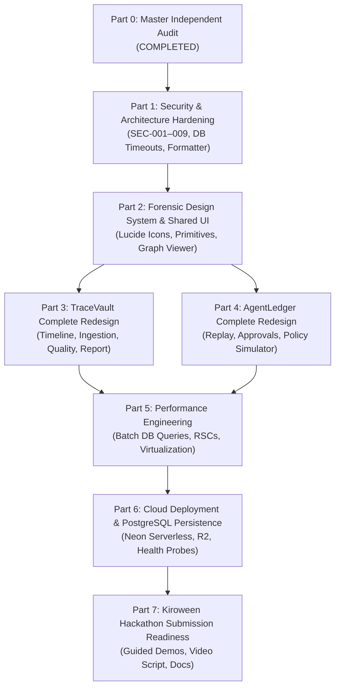

# EvidenceKit Master Implementation Roadmap & Dependency Blueprint

**Project:** EvidenceKit (TraceVault & AgentLedger)  
**Lead Architect:** Principal Software Architect  
**Blueprint Scope:** Post-Part 0 Phased Execution (Parts 1 through 7)  
**Date:** 2026-11-11  

---

## 1. Roadmap Architecture & Execution Principles

This roadmap organizes the evolution of EvidenceKit into **7 distinct, sequential parts**. Each part has explicit entry requirements, dependency boundaries, risk mitigations, and verifiable definitions of done.

---

## 2. Detailed Part-by-Part Execution Blueprint

### Part 1 — Security & Architecture Hardening
- **Objective**: Eliminate all confirmed Critical/High security vulnerabilities, stabilize the Vitest test suite to 100% pass rate, fix Prettier formatting, and add database pre-flight checks.
- **Exact Modules & Files**:
  - `packages/evidence-server/src/authorization/index.ts`
  - `packages/evidence-core/src/signatures/index.ts`
  - `packages/evidence-server/src/services/incident-service.ts`
  - `packages/evidence-server/src/services/agent-session-service.ts`
  - `packages/evidence-server/src/services/export-bundle-service.ts`
  - `apps/agentledger/app/api/agentledger/sessions/[id]/tool-call/route.ts`
  - `packages/db/src/client.ts`
  - `tests/agent-scale.test.ts`
  - `fixtures/**/*.json`
- **Dependencies**: None (Part 0 findings baseline).
- **Core Tasks**:
  1. Fix SEC-001: Remove hardcoded `"owner"` / `"local-dev-owner"` bypasses in `evaluateSessionContext`.
  2. Fix SEC-002 & SEC-003: Add public key trust validation and prevent signature stripping in `verifyManifestSignature`.
  3. Fix SEC-004: Restrict `workspaceId` overrides in `listIncidents` and `getEvidenceGraph`.
  4. Fix SEC-005: Wire persistent Ed25519 signing keys from `process.env`.
  5. Fix SEC-007: Forward `workspaceId` in `tool-call/route.ts`.
  6. Add DB connection probe with 1500ms timeout in `packages/db/src/client.ts` and fast in-memory failover.
  7. Relax rigid 100ms timing assertion in `tests/agent-scale.test.ts`.
  8. Run `pnpm format` to align JSON fixture files.
- **Acceptance Criteria**:
  - `pnpm format:check` exits with 0.
  - `pnpm lint` exits with 0.
  - `pnpm typecheck` exits with 0.
  - `pnpm test` executes all 129 tests with 100% pass rate (zero timeouts, zero assertion failures).
- **Complexity**: Medium.
- **Estimated Effort**: 1 focused engineering sprint.
- **Definition of Done**: All 4 quality gates pass cleanly on local machines without a running PostgreSQL database.

---

### Part 2 — Shared Forensic Design System & Component Library
- **Objective**: Build a cohesive, enterprise-grade forensic design system in `packages/ui` using Lucide icons, unified typography, and bespoke visualization primitives.
- **Exact Modules & Files**:
  - `packages/ui/src/primitives/*`
  - `packages/ui/src/components/*`
  - `packages/ui/src/tokens.ts` (or CSS variables)
  - `apps/tracevault/app/globals.css`
  - `apps/agentledger/app/globals.css`
- **Dependencies**: Part 1.
- **Core Tasks**:
  1. Purge all raw emojis (`📁`, `📥`, `📄`, `🛡️`, `🔍`, `🔐`) from code.
  2. Build `<HashPill />` component with truncation, copy button, and verification link.
  3. Build `<EvidenceGraphViewer />` using clean, lightweight SVG node-link rendering (supporting drag, zoom, and highlight).
  4. Build `<DiffViewer />` with side-by-side and unified line diffing for sandbox file changes.
  5. Build `<OfflineVerifierWidget />` utilizing in-browser Web Crypto API (`crypto.subtle`).
  6. Standardize status badges: `ALLOW` (green), `REQUIRE_APPROVAL` (amber), `DENY` (red).
- **Acceptance Criteria**:
  - Zero emoji icons in UI.
  - All icons rendered consistently with `lucide-react` at 1.75px stroke.
  - Storybook / UI package tests verify all primitives render without errors.
- **Complexity**: Medium.
- **Estimated Effort**: 1 UI/UX design and component extraction sprint.
- **Definition of Done**: `@evidencekit/ui` exports complete suite of forensic components used by both apps.

---

### Part 3 — TraceVault Investigation Experience Redesign
- **Objective**: Redesign the entire software incident investigation lifecycle in TraceVault to feel like a high-density forensic workstation.
- **Exact Modules & Files**:
  - `apps/tracevault/app/layout.tsx`
  - `apps/tracevault/app/page.tsx`
  - `apps/tracevault/app/incidents/page.tsx`
  - `apps/tracevault/app/incidents/new/page.tsx`
  - `apps/tracevault/app/incidents/[id]/layout.tsx`
  - `apps/tracevault/app/incidents/[id]/page.tsx`
  - `apps/tracevault/app/incidents/[id]/timeline/page.tsx`
  - `apps/tracevault/app/incidents/[id]/evidence/page.tsx`
  - `apps/tracevault/app/incidents/[id]/quality/page.tsx`
  - `apps/tracevault/app/incidents/[id]/report/page.tsx`
  - `apps/tracevault/app/verify/page.tsx`
- **Dependencies**: Part 2.
- **Core Tasks**:
  1. Replace generic hero banner with a dense Incident Command Center header.
  2. Redesign `/incidents/[id]/timeline` with chronological virtualized event cards, source badges, and hash inspector drawer.
  3. Redesign `/incidents/[id]/evidence` with drag-and-drop artifact workstation and real-time SHA-256 calculation.
  4. Upgrade `/verify` to perform 100% client-side in-browser cryptographic verification.
  5. Integrate `<EvidenceGraphViewer />` on `/graph`.
- **Acceptance Criteria**:
  - Zero monolithic 400-line pages; components modularized under `apps/tracevault/components/`.
  - Offline verification works with browser network disabled.
  - Playwright specs for TraceVault pass 100%.
- **Complexity**: High.
- **Estimated Effort**: 1 frontend application sprint.
- **Definition of Done**: Complete TraceVault user journey passes automated browser tests with zero console errors.

---

### Part 4 — AgentLedger AI Governance & Replay Redesign
- **Objective**: Redesign AgentLedger to deliver an unmatched AI agent monitoring, policy simulation, and time-travel replay experience.
- **Exact Modules & Files**:
  - `apps/agentledger/app/layout.tsx`
  - `apps/agentledger/app/page.tsx`
  - `apps/agentledger/app/sessions/page.tsx`
  - `apps/agentledger/app/sessions/new/page.tsx`
  - `apps/agentledger/app/sessions/[id]/layout.tsx`
  - `apps/agentledger/app/sessions/[id]/timeline/page.tsx`
  - `apps/agentledger/app/sessions/[id]/replay/page.tsx`
  - `apps/agentledger/app/sessions/[id]/files/page.tsx`
  - `apps/agentledger/app/sessions/[id]/approvals/page.tsx`
  - `apps/agentledger/app/policies/page.tsx`
  - `apps/agentledger/app/verify/page.tsx`
- **Dependencies**: Part 2.
- **Core Tasks**:
  1. Upgrade `/sessions/[id]/replay` with an interactive timeline scrubber, step-by-step diff playback, and cryptographic state hash badges.
  2. Redesign `/policies` with visual rule editor and live policy simulation playground.
  3. Redesign `/sessions/[id]/approvals` with prominent human-in-the-loop decision cards and zero-mutation guarantees.
  4. Upgrade `/verify` to client-side in-browser verification.
- **Acceptance Criteria**:
  - Components modularized under `apps/agentledger/components/`.
  - Replay slider scrubs seamlessly without DOM lag.
  - Playwright specs for AgentLedger pass 100%.
- **Complexity**: High.
- **Estimated Effort**: 1 frontend application sprint.
- **Definition of Done**: Complete AgentLedger user journey passes automated browser tests with zero console errors.

---

### Part 5 — Performance Engineering & Query Optimization
- **Objective**: Optimize frontend rendering with React Server Components, batch backend database queries to eliminate N+1 cascades, and ensure instantaneous response times under scale.
- **Exact Modules & Files**:
  - `packages/evidence-server/src/services/evidence-graph-service.ts`
  - `packages/evidence-server/src/services/incident-service.ts`
  - `packages/evidence-server/src/services/agent-session-service.ts`
  - `apps/tracevault/app/page.tsx`
  - `apps/agentledger/app/page.tsx`
- **Dependencies**: Parts 3 & 4.
- **Core Tasks**:
  1. Fix PERF-001: Replace sequential database loops in `evidence-graph-service.ts` with batch `inArray(...)` queries (reduces DB calls from 152 to 3).
  2. Convert top-level dashboard pages (`apps/*/app/page.tsx`) to React Server Components (RSC) with zero-JS initial HTML rendering.
  3. Add memoization and debounced search filters on incident and session tables.
  4. Run performance benchmark suite verifying all throughput targets.
- **Acceptance Criteria**:
  - Graph retrieval latency under 50ms with 1,000 events.
  - Zero N+1 query patterns in backend services.
- **Complexity**: Medium.
- **Estimated Effort**: 1 systems performance sprint.
- **Definition of Done**: All performance benchmarks pass with measurements documented in updated reports.

---

### Part 6 — Cloud Integration & Persistent PostgreSQL
- **Objective**: Deploy live serverless PostgreSQL (e.g. Neon), create missing schema migrations for policies, configure persistent Ed25519 keys, and verify production cloud hosting.
- **Exact Modules & Files**:
  - `packages/db/src/schema/index.ts`
  - `packages/db/migrations/*`
  - `packages/evidence-server/src/services/agent-policy-service.ts`
  - `.github/workflows/ci.yml`
- **Dependencies**: Part 5.
- **Core Tasks**:
  1. Add `policies` table schema in `@evidencekit/db` and generate migration `0003_add_policies_table.sql`.
  2. Wire `AgentPolicyService` to persist custom policy versions in PostgreSQL.
  3. Add PostgreSQL service container to GitHub Actions `.github/workflows/ci.yml` so CI verifies real database migrations and integration tests.
  4. Deploy staging/production instances on Vercel / Railway with Neon Postgres.
- **Acceptance Criteria**:
  - Database migrations execute cleanly with `pnpm db:migrate`.
  - Data survives container restarts in production.
  - GitHub Actions CI pipeline passes with real PostgreSQL service.
- **Complexity**: High.
- **Estimated Effort**: 1 DevOps and reliability sprint.
- **Definition of Done**: Both applications accessible over public HTTPS URLs backed by persistent cloud PostgreSQL.

---

### Part 7 — Kiroween 2026 Hackathon Demo & Submission
- **Objective**: Package the completed project for maximum judging impact in the **Skeleton Crew** category.
- **Exact Modules & Files**:
  - `fixtures/scenarios/*`
  - `README.md`
  - `SUBMISSION.md`
  - Video recording assets
- **Dependencies**: Part 6.
- **Core Tasks**:
  1. Build "Launch 1-Click Guided Demo" button in both apps showcasing:
     - Incident reconstruction from 3 sources (CI, Git, K8s).
     - Agent safety governance: Policy DENY on `.env` read, human approval on config write, zero-mutation guarantee on denial.
     - Tamper detection demo: Live demonstration of an altered event breaking the SHA-256 chain.
  2. Author clear, compelling 3-minute video script covering:
     - The "Skeleton Crew" core thesis: 1 reusable engine powering 2 distinct apps.
     - Cryptographic verification and scientific honesty.
     - Kiro usage showcase (`.kiro/specs/`, `.kiro/steering/`, `.kiro/hooks/`).
  3. Finalize Devpost submission text and verify open-source license.
- **Acceptance Criteria**:
  - 3-minute demo video recorded and uploaded to YouTube.
  - Devpost submission drafted and reviewed against official rules.
- **Complexity**: Low.
- **Estimated Effort**: 1 presentation & documentation sprint.
- **Definition of Done**: Project submitted on Devpost prior to December 4, 2026 deadline.

