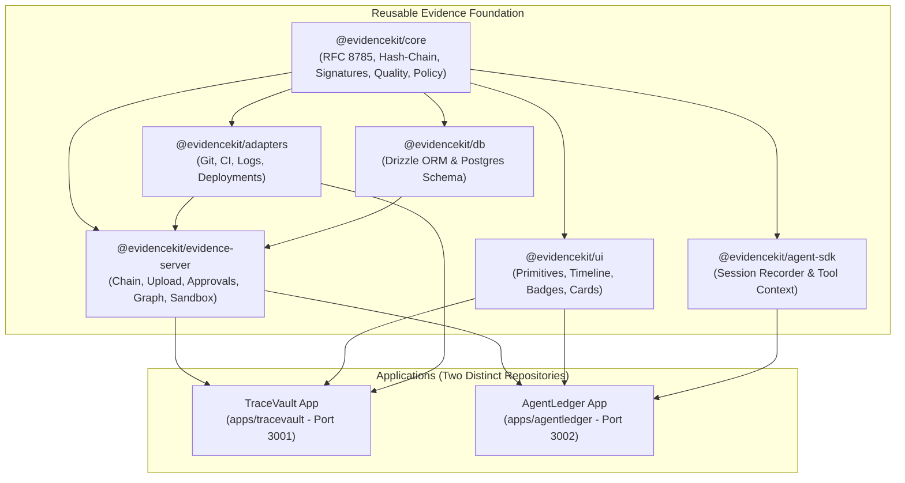
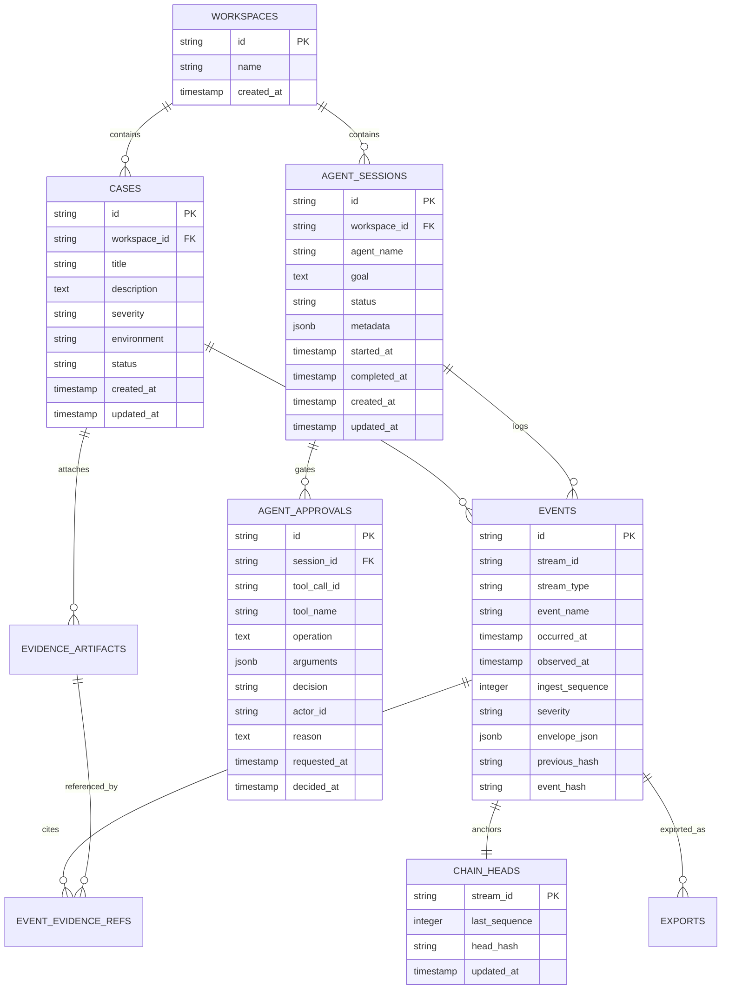

# EvidenceKit Repository Architecture Audit

**Project:** EvidenceKit  
**Auditor:** Principal Software Architect & DevOps Lead  
**Audit Date:** 2026-11-11  
**Monorepo Branch:** `feature/phase-4.5-governance-and-differentiation`  
**Commit:** `2366644`  

---

## 1. Monorepo Structure & Package Topology

EvidenceKit is structured as a pnpm workspace monorepo configured in `pnpm-workspace.yaml`. It contains 2 Next.js frontend applications and 6 internal workspace packages under `packages/`.

```
evidencekit/
├── apps/
│   ├── tracevault/            # Incident reconstruction application (Port 3001)
│   └── agentledger/           # AI agent activity auditing application (Port 3002)
├── packages/
│   ├── evidence-core/         # Pure domain logic: RFC 8785 canonicalization, hash chain, policy, quality
│   ├── adapters/              # Ingestion adapters: CI logs, Git commits, deployment manifests, app logs
│   ├── agent-sdk/             # Agent runtime instrumentation & session recorder
│   ├── db/                    # Drizzle ORM PostgreSQL schema, connection pool, migrations
│   ├── evidence-server/       # Node.js backend services: chaining, approvals, policies, graph, upload
│   └── ui/                    # Shared React UI components (primitives and event widgets)
├── fixtures/                  # Static test fixtures, sandbox templates, and sample bundles
├── tests/                     # 31 Vitest test suites (129 automated tests)
├── e2e/                       # 4 Playwright end-to-end browser specs (12 tests)
└── .kiro/                     # Kiro IDE configuration: specs, steering rules, and automation hooks
```

---

## 2. Independence of TraceVault & AgentLedger

A central requirement of the **Skeleton Crew** hackathon category is to prove that the two applications are **genuinely distinct applications** rather than cosmetic clones of one interface, while sharing a common reusable core.

### 2.1 Distinct Application Domains
1. **TraceVault (`apps/tracevault`)**:
   - **Domain Object**: `case` (Software Incident Case).
   - **Target Audience**: Site Reliability Engineers, DevOps teams, Incident Commanders.
   - **Workflow**: Create incident case -> Ingest multi-source log bundles (CI, Git, deployments) -> Strip credentials -> Hash-chain normalize -> Inspect timeline -> Correlate anomalies -> Generate post-incident forensic report -> Export signed evidence bundle.
   - **Primary Ports**: Port 3001.

2. **AgentLedger (`apps/agentledger`)**:
   - **Domain Object**: `agent_session` (Instrumented AI Agent Session).
   - **Target Audience**: AI Safety Engineers, Compliance Reviewers, LLM Application Developers.
   - **Workflow**: Initialize session with target goal -> Execute sandboxed tools (`list_files`, `read_file`, `create_file`, `modify_file`) -> Intercept calls with Policy Engine (`ALLOW`, `REQUIRE_APPROVAL`, `DENY`) -> Human-in-the-loop approval gates -> Enforce zero-mutation on denial -> Track file diffs & hashes -> Replay session state step-by-step -> Export signed audit ledger.
   - **Primary Ports**: Port 3002.

### 2.2 Shared Foundation vs. App-Specific Dependencies



---

## 3. Comprehensive Architecture Component Inventory

| Component | Physical Path | Primary Purpose | Key Dependencies | Data Ownership | Failure Impact |
| :--- | :--- | :--- | :--- | :--- | :--- |
| **Canonicalizer** | `packages/evidence-core/src/canonicalize` | Deterministic RFC 8785 JSON canonicalization | `canonicalize` package | Stateless | Inconsistent event hashes; broken chain verification |
| **Hash Chain** | `packages/evidence-core/src/chain` | Genesis anchoring, SHA-256 event chaining, tamper detection | Node `crypto` | Stateless | Chain corruption, silent tampering undetected |
| **Normalizer** | `packages/evidence-core/src/normalize` | Normalizes heterogeneous events into EvidenceKit envelope v1.0 | `zod` | Envelopes | Schema validation failures; dropped events |
| **Sanitizer & Redactor**| `packages/evidence-core/src/redact` | Detects and masks API keys, secrets, tokens before persistence | Regex rules | Redacted attributes | Secret leakage into persistent logs |
| **Digital Signatures** | `packages/evidence-core/src/signatures` | Ed25519 signing, manifest canonicalization, key fingerprinting | Node `crypto` | Manifest receipts | Unverifiable export bundles; forgeable manifests |
| **Policy Engine** | `packages/evidence-core/src/policy` | Deterministic rule precedence evaluation (`ALLOW`, `DENY`) | Pure TS | Policy specs | Unauthorized agent tool execution |
| **Quality Engine** | `packages/evidence-core/src/quality` | Forensic completeness scoring (0–100), clock-skew analysis | Pure TS | Quality reports | Blindness to missing provenance or duplicate events |
| **Evidence Graph** | `packages/evidence-core/src/graph` | Multi-stream topology representation (explicit vs inferred) | Pure TS | Graph models | Inability to correlate incidents with agent sessions |
| **PostgreSQL DB** | `packages/db/src` | Persistence layer for workspaces, cases, sessions, events | `drizzle-orm`, `pg` | PostgreSQL data | Full service outage if database connection hangs |
| **Chain Service** | `packages/evidence-server/src/services/chain-service.ts` | Transactional append to DB and in-memory hash chain fallback | `@evidencekit/db` | Events & chain heads | Ingestion failure |
| **Sandbox Service**| `packages/evidence-server/src/services/agent-sandbox-service.ts` | Isolated workspace directory, path traversal prevention, file diffs | Node `fs` | Sandbox files | Arbitrary filesystem escape or file corruption |
| **Approval Service**| `packages/evidence-server/src/services/agent-approval-service.ts` | Human-in-the-loop approval workflow, zero-mutation enforcement | `@evidencekit/db` | Approvals | Unauthorized state changes on denied tool calls |

---

## 4. API Inventory & Contract Audit

### 4.1 TraceVault API Endpoints (`apps/tracevault`)

| Route | Method | Auth Required | Input Validation | Database Dependency | Error Handling | Security Concerns |
| :--- | :--- | :--- | :--- | :--- | :--- | :--- |
| `/api/health` | GET | None | None | None | 200 JSON | None (Public liveness) |
| `/api/incidents` | GET | Optional (Judge) | `IncidentQuerySchema` | `cases` table | 500 JSON | IDOR: `workspaceId` can be overridden in query |
| `/api/incidents` | POST | Owner | `CreateIncidentInputSchema` | `cases`, `workspaces` | 400/403/500 JSON | Auth bypass via `x-evidencekit-user: owner` |
| `/api/incidents/[id]` | GET | Optional (Judge) | ID in URL | `cases` table | 404/500 JSON | Unauthenticated read in demo mode |
| `/api/incidents/[id]` | PATCH | Owner | `UpdateIncidentInputSchema` | `cases` table | 400/403/500 JSON | Auth bypass via spoofed header |
| `/api/incidents/[id]` | DELETE | Owner | ID in URL | `cases` table (cascade) | 400/403/500 JSON | Auth bypass via spoofed header |
| `/api/incidents/[id]/evidence` | GET | Optional (Judge) | ID in URL | `evidence_artifacts` | 500 JSON | Read-only artifact metadata |
| `/api/incidents/[id]/evidence` | POST | Owner | Multipart FormData | `evidence_artifacts`, `events` | 400/403/500 JSON | Unvalidated ZIP entry bomb protection needed |
| `/api/incidents/[id]/timeline` | GET | Optional (Judge) | Query params | `events` table | 500 JSON | Unbounded query risk if `limit` omitted |
| `/api/incidents/[id]/correlations` | GET | Optional (Judge) | ID in URL | `events` table | 500 JSON | Heavy correlation computation on large streams |
| `/api/incidents/[id]/quality` | GET | Optional (Judge) | ID in URL | `events` table | 500 JSON | Evaluates all events in stream memory |
| `/api/incidents/[id]/report` | GET | Optional (Judge) | ID in URL | `cases`, `events` | 500 JSON | Large report payload generation |
| `/api/incidents/[id]/export` | GET | Optional (Judge) | `?format=json\|zip` | `events`, `chain_heads` | 400/500 JSON | Private key ephemeral generation on restart |
| `/api/evidence/graph` | GET | Optional (Judge) | `GraphQueryParamsSchema` | `cases`, `sessions`, `events` | 500 JSON | N+1 query cascade (up to 151 DB calls) |
| `/api/evidence/verify` | POST | None | Multipart FormData | None (Stateless) | 400/500 JSON | Not genuinely offline; public-key substitution |

### 4.2 AgentLedger API Endpoints (`apps/agentledger`)

| Route | Method | Auth Required | Input Validation | Database Dependency | Error Handling | Security Concerns |
| :--- | :--- | :--- | :--- | :--- | :--- | :--- |
| `/api/health` | GET | None | None | None | 200 JSON | None |
| `/api/agentledger/sessions` | GET | Optional (Judge) | `AgentSessionQuerySchema` | `agent_sessions` table | 500 JSON | IDOR via query parameter `workspaceId` |
| `/api/agentledger/sessions` | POST | Owner | `CreateAgentSessionInputSchema`| `agent_sessions`, `events` | 400/403/500 JSON | Auth bypass via `x-evidencekit-user: owner` |
| `/api/agentledger/sessions/[id]` | GET | Optional (Judge) | ID in URL | `agent_sessions` table | 404/500 JSON | None |
| `/api/agentledger/sessions/[id]` | PATCH | Owner | `UpdateAgentSessionInputSchema`| `agent_sessions` table | 400/403/500 JSON | Auth bypass via spoofed header |
| `/api/agentledger/sessions/[id]` | DELETE | Owner | ID in URL | `agent_sessions` table | 400/403/500 JSON | Auth bypass via spoofed header |
| `/api/agentledger/sessions/[id]/timeline` | GET | Optional (Judge) | ID in URL | `events` table | 500 JSON | Memory allocation on large event logs |
| `/api/agentledger/sessions/[id]/tool-call` | POST | Owner | JSON `{ toolName, args }` | `events`, filesystem sandbox | 400/403/500 JSON | Workspace ID omitted in service call |
| `/api/agentledger/sessions/[id]/approvals` | GET | Optional (Judge) | ID in URL | `agent_approvals` table | 500 JSON | None |
| `/api/agentledger/sessions/[id]/approvals` | POST | Optional / Owner | `DecideApprovalInputSchema` | `agent_approvals`, `events` | 400/403/500 JSON | Request approval requires NO auth |
| `/api/agentledger/sessions/[id]/files` | GET | Optional (Judge) | ID in URL | Filesystem sandbox | 500 JSON | Path traversal risk if unvalidated |
| `/api/agentledger/sessions/[id]/replay` | GET | Optional (Judge) | ID in URL | `events` table | 500 JSON | Deterministic replay CPU overhead |
| `/api/agentledger/sessions/[id]/demo/run` | POST | Owner | JSON `{ agentName, goal }` | `agent_sessions`, `events` | 400/403/500 JSON | Executes multiple tool calls sequentially |
| `/api/agentledger/sessions/[id]/export` | GET | Optional (Judge) | `?format=json\|zip` | `events`, `chain_heads` | 400/500 JSON | Ephemeral signing key generation |
| `/api/agentledger/policies` | GET | Optional (Judge) | `?workspaceId=...` | In-memory policy map | 200 JSON | No database table for policies |
| `/api/agentledger/policies` | POST | Owner | `AgentPolicySchema` | In-memory policy map | 400/403/500 JSON | Lost on server restart |
| `/api/agentledger/policies/simulate` | POST | None | `PolicyEvaluationRequestSchema`| Pure logic | 200 JSON | Safe simulation endpoint |
| `/api/agentledger/graph` | GET | Optional (Judge) | `GraphQueryParamsSchema` | `cases`, `sessions`, `events` | 500 JSON | Identical copy of TraceVault route |
| `/api/agentledger/verify` | POST | None | JSON body | None (Stateless) | 400/500 JSON | Not offline; public-key substitution |

---

## 5. Database Inventory & Data Model

The database layer is managed by **Drizzle ORM** (`drizzle-orm@0.39.3`) targeting **PostgreSQL** (`pg@8.13.1`). Schema definitions reside in `packages/db/src/schema/index.ts`.

### 5.1 Relational Schema Diagram



### 5.2 Critical Schema Deficiencies Identified
1. **Missing `policies` Table**: The entire AgentLedger Policy Engine (`AgentPolicy`, `PolicyRule`) has no corresponding table in `@evidencekit/db`. Policies are stored in an in-memory `Map<string, AgentPolicy[]>` inside `AgentPolicyService`. Any server restart or serverless cold start completely loses custom policy rules.
2. **Missing Foreign Key on `events.stream_id`**: Because `stream_id` is polymorphic (can reference either `cases.id` or `agent_sessions.id`), no database foreign key constraint exists. Orphan events can exist if a case or session is deleted without transactional cascading.
3. **Absence of Read-Replica / Multi-Region Pool**: The connection pool in `packages/db/src/client.ts` is a single static pool without connection pooling for serverless environments (e.g. PgBouncer / Neon connection pooling).

